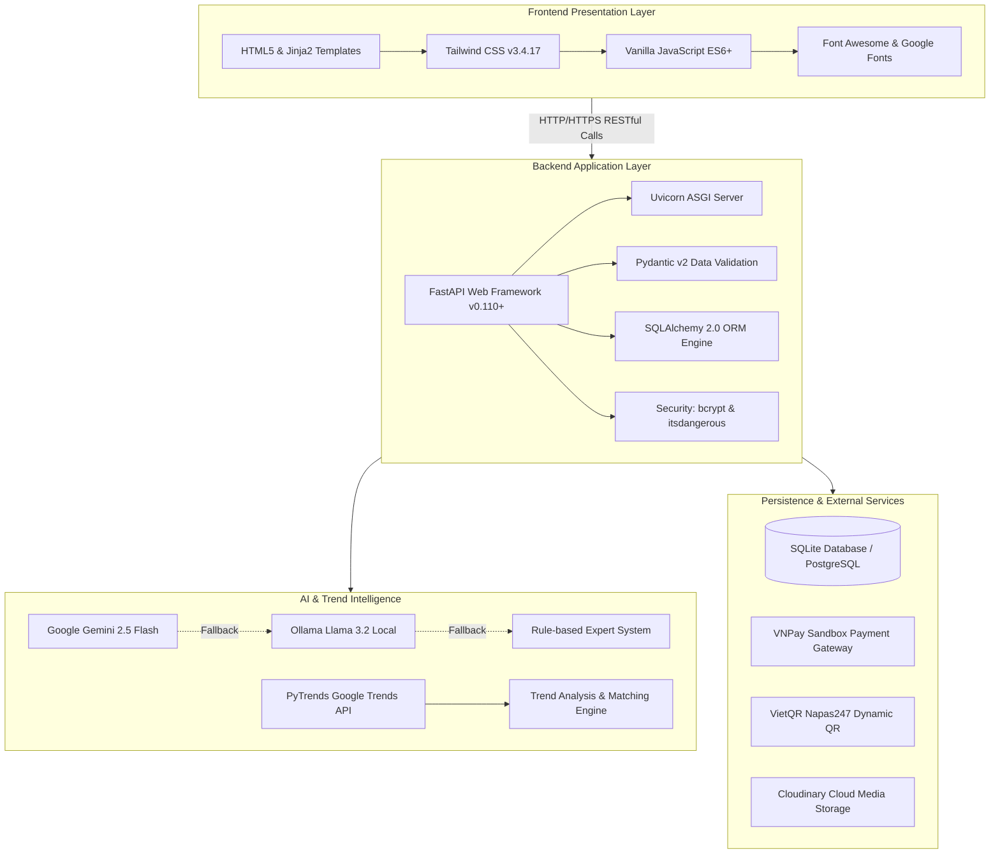
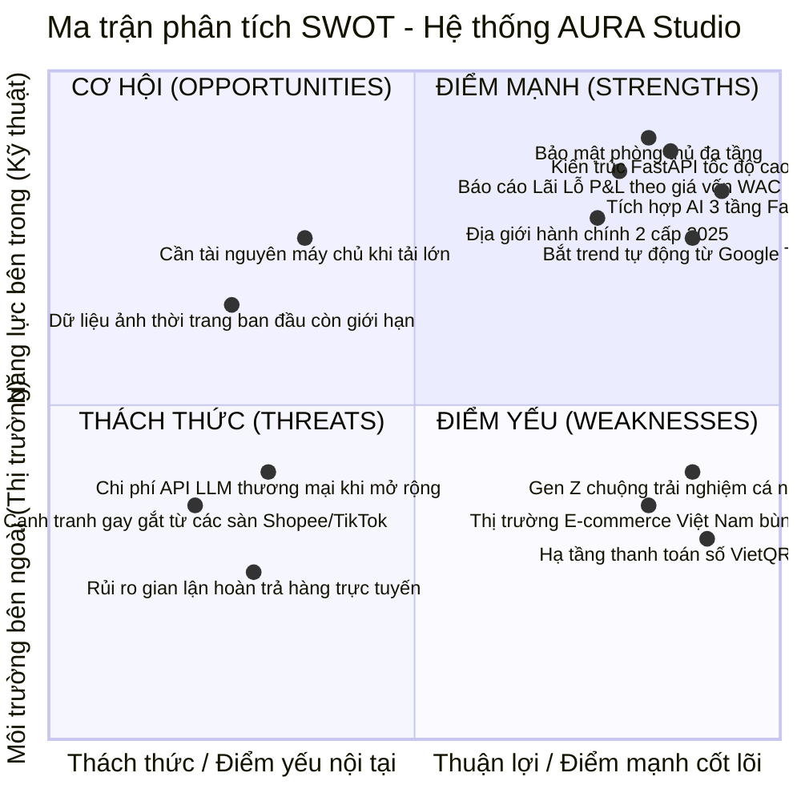
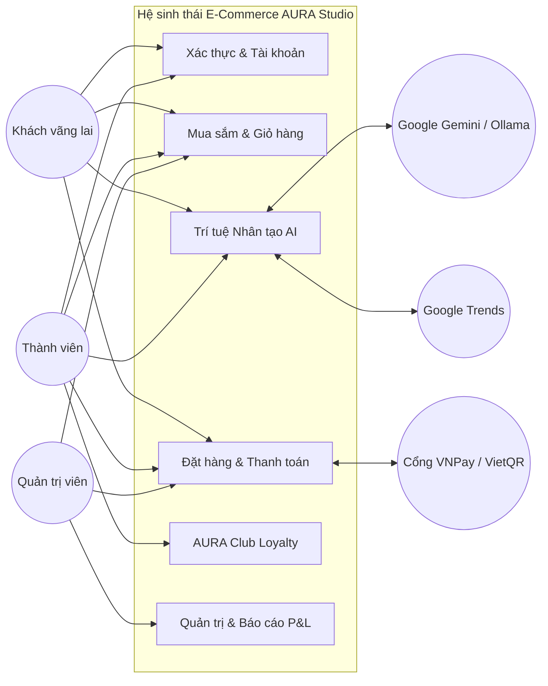
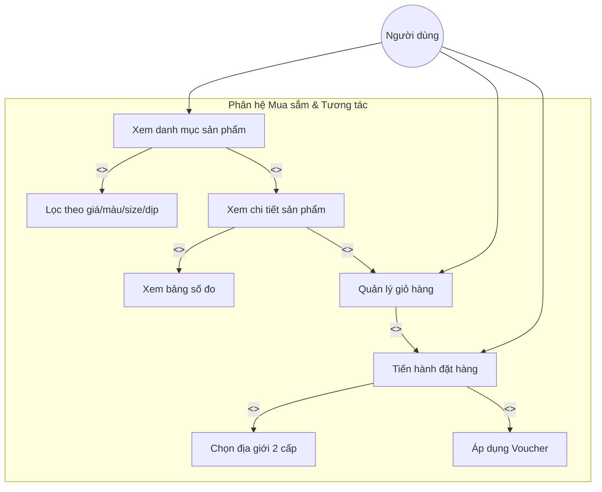
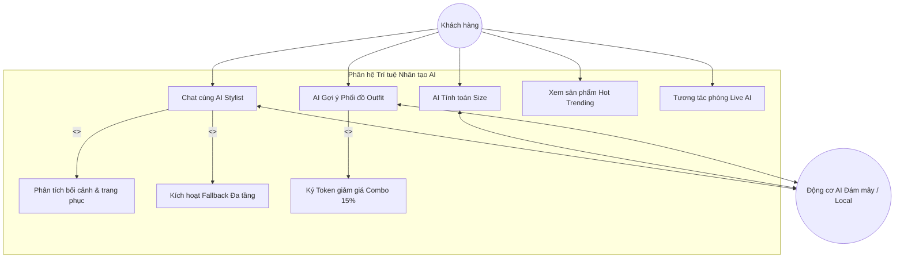
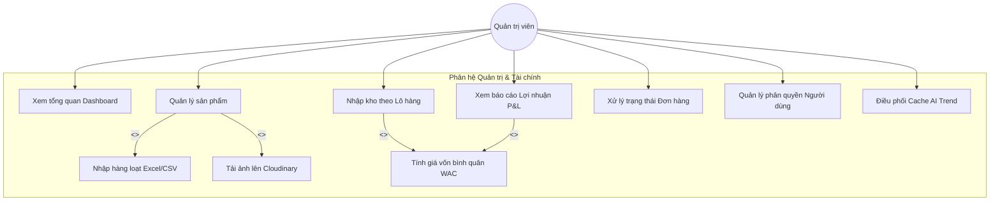
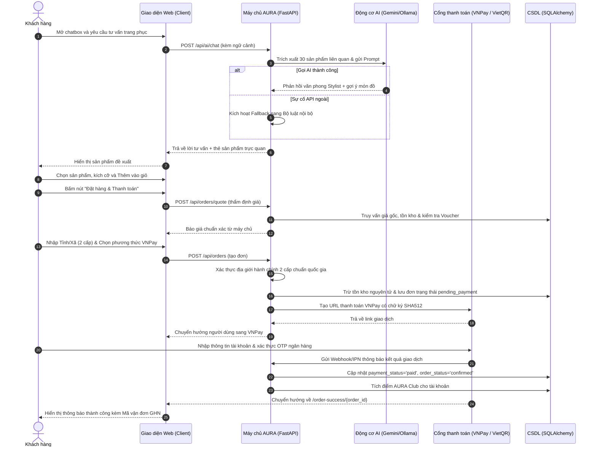
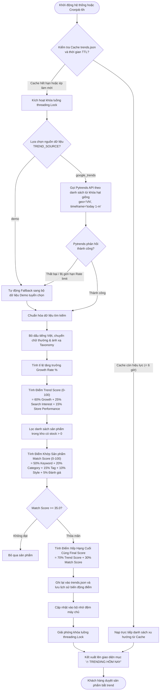
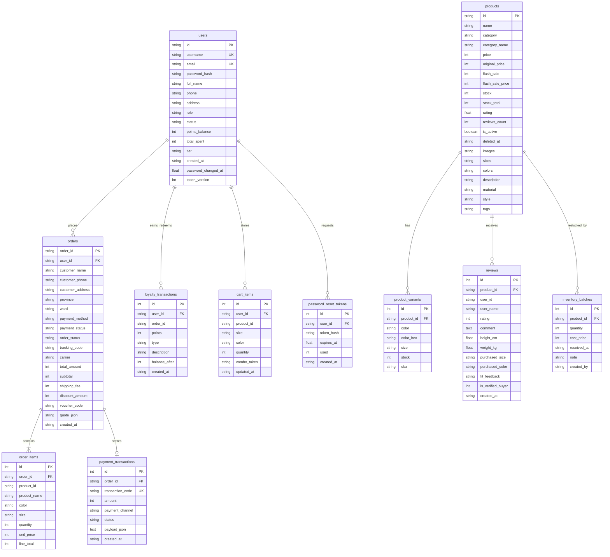

# TRƯỜNG CAO ĐẲNG FPT POLYTECHNIC
### KHOA CÔNG NGHỆ THÔNG TIN
---
### BÁO CÁO DỰ ÁN TỐT NGHIỆP
# ĐỀ TÀI: XÂY DỰNG HỆ THỐNG THƯƠNG MẠI ĐIỆN TỬ THỜI TRANG TÍCH HỢP TRÍ TUỆ NHÂN TẠO (AI FASHION E-COMMERCE) - AURA STUDIO

* **Chuyên ngành:** Lập trình Web / Phát triển Phần mềm
* **Giảng viên hướng dẫn:** ThS. [Điền tên Giảng viên hướng dẫn]
* **Nhóm thực hiện:** Nhóm AURA
* **Thành viên tham gia:**
  1. Nguyễn Văn Thuận – PH00001 (Trưởng nhóm - Backend & AI Architect)
  2. Nguyễn Văn A – PH00002 (Frontend & UI/UX Developer)
  3. Trần Văn B – PH00003 (Database & Security Engineer)
  4. Lê Thị C – PH00004 (Tester & Quality Assurance)
  5. Phạm Văn D – PH00005 (Business Analyst & Kỹ thuật tài liệu)

**Hà Nội – 2026**

---

## MỤC LỤC

- [LỜI MỞ ĐẦU](#lời-mở-đầu)
- [GIẢI THÍCH THUẬT NGỮ](#giải-thích-thuật-ngữ)
- [PHẦN 1. GIỚI THIỆU CHUNG](#phần-1-giới-thiệu-chung)
  - [1.1. Giới thiệu đề tài](#11-giới-thiệu-đề-tài)
    - [1.1.1. Lý do chọn đề tài](#111-lý-do-chọn-đề-tài)
    - [1.1.2. Mục tiêu làm đề tài](#112-mục-tiêu-làm-đề-tài)
  - [1.2. Thành viên tham gia dự án và phân công nhiệm vụ](#12-thành-viên-tham-gia-dự-án-và-phân-công-nhiệm-vụ)
  - [1.3. Các công cụ và công nghệ sử dụng](#13-các-công-cụ-và-công-nghệ-sử-dụng)
    - [1.3.1. Các công cụ phát triển](#131-các-công-cụ-phát-triển)
    - [1.3.2. Ngăn xếp công nghệ (Technology Stack)](#132-ngăn-xếp-công-nghệ-technology-stack)
- [PHẦN 2. KHẢO SÁT HỆ THỐNG](#phần-2-khảo-sát-hệ-thống)
  - [2.1. Bài toán nghiệp vụ thực tế](#21-bài-toán-nghiệp-vụ-thực-tế)
  - [2.2. Khảo sát các hệ thống tương tự trên thị trường](#22-khảo-sát-các-hệ-thống-tương-tự-trên-thị-trường)
  - [2.3. Đối tượng sử dụng hệ thống](#23-đối-tượng-sử-dụng-hệ-thống)
- [PHẦN 3. PHÂN TÍCH HỆ THỐNG](#phần-3-phân-tích-hệ-thống)
  - [3.1. Phân tích hiện trạng theo mô hình SWOT](#31-phân-tích-hiện-trạng-theo-mô-hình-swot)
  - [3.2. Danh sách tác nhân (Actors)](#32-danh-sách-tác-nhân-actors)
  - [3.3. Danh sách các Use Case hệ thống](#33-danh-sách-các-use-case-hệ-thống)
  - [3.4. Mô hình hệ thống (Use Case Diagrams)](#34-mô-hình-hệ-thống-use-case-diagrams)
    - [3.4.1. Sơ đồ Use Case tổng quát](#341-sơ-đồ-use-case-tổng-quát)
    - [3.4.2. Sơ đồ Use Case phân hệ Mua sắm & Tương tác](#342-sơ-đồ-use-case-phân-hệ-mua-sắm--tương-tác)
    - [3.4.3. Sơ đồ Use Case phân hệ Trợ lý Trí tuệ Nhân tạo AI](#343-sơ-đồ-use-case-phân-hệ-trợ-lý-trí-tuệ-nhân-tạo-ai)
    - [3.4.4. Sơ đồ Use Case phân hệ Quản trị (Admin System)](#344-sơ-đồ-use-case-phân-hệ-quản-trị-admin-system)
  - [3.5. Bảng mô tả chi tiết các Use Case chính](#35-bảng-mô-tả-chi-tiết-các-use-case-chính)
  - [3.6. Ma trận phân quyền chức năng (RBAC Matrix)](#36-ma-trận-phân-quyền-chức-năng-rbac-matrix)
  - [3.7. Sơ đồ hoạt động (Swimlane Activity Diagrams)](#37-sơ-đồ-hoạt-động-swimlane-activity-diagrams)
    - [3.7.1. Sơ đồ quy trình Tư vấn AI, Đặt hàng & Thanh toán Trực tuyến](#371-sơ-đồ-quy-trình-tư-vấn-ai-đặt-hàng--thanh-toán-trực-tuyến)
    - [3.7.2. Sơ đồ quy trình Phát hiện Xu hướng Thời trang (AI Trend Engine)](#372-sơ-đồ-quy-trình-phát-hiện-xu-hướng-thời-trang-ai-trend-engine)
    - [3.7.3. Sơ đồ quy trình Nhập kho, Tính giá vốn WAC & Kết chuyển P&L](#373-sơ-đồ-quy-trình-nhập-kho-tính-giá-vốn-wac--kết-chuyển-pl)
- [PHẦN 4. THIẾT KẾ HỆ THỐNG](#phần-4-thiết-kế-hệ-thống)
  - [4.1. Thiết kế kiến trúc hệ thống](#41-thiết-kế-kiến-trúc-hệ-thống)
  - [4.2. Thiết kế giao diện người dùng (UI/UX)](#42-thiết-kế-giao-diện-người-dùng-uiux)
  - [4.3. Thuật toán và công nghệ đặc sắc](#43-thuật-toán-và-công-nghệ-đặc-sắc)
    - [4.3.1. Thuật toán phát hiện xu hướng đa tầng (Multi-factor AI Trend Engine)](#431-thuật-toán-phát-hiện-xu-hướng-đa-tầng-multi-factor-ai-trend-engine)
    - [4.3.2. Cơ chế Fallback 3 tầng và kiểm soát đồng thời (Semaphore Concurrency) cho AI Stylist](#432-cơ-chế-fallback-3-tầng-và-kiểm-soát-đồng-thời-semaphore-concurrency-cho-ai-stylist)
    - [4.3.3. Thuật toán tính Giá vốn Bình quân Gia quyền (WAC) và Phân bổ Doanh thu Ròng](#433-thuật-toán-tính-giá-vốn-bình-quân-gia-quyền-wac-và-phân-bổ-doanh-thu-ròng)
- [PHẦN 5. XÂY DỰNG CƠ SỞ DỮ LIỆU](#phần-5-xây-dựng-cơ-sở-dữ-liệu)
  - [5.1. Sơ đồ quan hệ thực thể (ERD Diagram)](#51-sơ-đồ-quan-hệ-thực-thể-erd-diagram)
  - [5.2. Đặc tả chi tiết các bảng trong cơ sở dữ liệu](#52-đặc-tả-chi-tiết-các-bảng-trong-cơ-sở-dữ-liệu)
    - [5.2.1. Bảng `users` (Quản lý người dùng)](#521-bảng-users-quản-lý-người-dùng)
    - [5.2.2. Bảng `orders` (Quản lý đơn hàng)](#522-bảng-orders-quản-lý-đơn-hàng)
    - [5.2.3. Bảng `order_items` (Chi tiết dòng sản phẩm trong đơn)](#523-bảng-order_items-chi-tiết-dòng-sản-phẩm-trong-đơn)
    - [5.2.4. Bảng `products` (Quản lý thông tin sản phẩm)](#524-bảng-products-quản-lý-thông-tin-sản-phẩm)
    - [5.2.5. Bảng `product_variants` (Quản lý biến thể màu sắc và kích cỡ)](#525-bảng-product_variants-quản-lý-biến-thể-màu-sắc-và-kích-cỡ)
    - [5.2.6. Bảng `reviews` (Đánh giá và phản hồi của người mua thật)](#526-bảng-reviews-đánh-giá-và-phản-hồi-của-người-mua-thật)
    - [5.2.7. Bảng `payment_transactions` (Lịch sử giao dịch thanh toán)](#527-bảng-payment_transactions-lịch-sử-giao-dịch-thanh-toán)
    - [5.2.8. Bảng `loyalty_transactions` (Lịch sử tích và tiêu điểm AURA Club)](#528-bảng-loyalty_transactions-lịch-sử-tích-và-tiêu-điểm-aura-club)
    - [5.2.9. Bảng `inventory_batches` (Lịch sử nhập kho và giá vốn)](#529-bảng-inventory_batches-lịch-sử-nhập-kho-và-giá-vốn)
    - [5.2.10. Bảng `cart_items` (Giỏ hàng đồng bộ phía máy chủ)](#5210-bảng-cart_items-giỏ-hàng-đồng-bộ-phía-máy-chủ)
    - [5.2.11. Bảng `password_reset_tokens` (Mã bảo mật đặt lại mật khẩu)](#5211-bảng-password_reset_tokens-mã-bảo-mật-đặt-lại-mật-khẩu)
- [PHẦN 6. TRIỂN KHAI VÀ KIỂM THỬ HỆ THỐNG](#phần-6-triển-khai-và-kiểm-thử-hệ-thống)
  - [6.1. Yêu cầu phần cứng và môi trường phần mềm](#61-yêu-cầu-phần-cứng-và-môi-trường-phần-mềm)
  - [6.2. Kịch bản kiểm thử chi tiết (Test Cases)](#62-kịch-bản-kiểm-thử-chi-tiết-test-cases)
  - [6.3. Hướng dẫn cài đặt, cấu hình và danh sách tài khoản thử nghiệm](#63-hướng-dẫn-cài-đặt-cấu-hình-và-danh-sách-tài-khoản-thử-nghiệm)
- [PHẦN 7. KẾT LUẬN, LỜI CẢM ƠN VÀ TÀI LIỆU THAM KHẢO](#phần-7-kết-luận-lời-cảm-ơn-và-tài-liệu-tham-khảo)
  - [7.1. Kế hoạch và tiến độ phát triển dự án](#71-kế-hoạch-và-tiến-độ-phát-triển-dự-án)
  - [7.2. Đánh giá mức độ hoàn thiện tính năng](#72-đánh-giá-mức-độ-hoàn-thiện-tính-năng)
  - [7.3. Khó khăn, thách thức gặp phải và giải pháp khắc phục](#73-khó-khăn-thách-thức-gặp-phải-và-giải-pháp-khắc-phục)
  - [7.4. Bài học kinh nghiệm rút ra](#74-bài-học-kinh-nghiệm-rút-ra)
  - [7.5. Hướng phát triển và mở rộng trong tương lai](#75-hướng-phát-triển-và-mở-rộng-trong-tương-lai)
  - [LỜI CẢM ƠN](#lời-cảm-ơn)
  - [TÀI LIỆU THAM KHẢO](#tài-liệu-tham-khảo)

---

## LỜI MỞ ĐẦU

Trong làn sóng bùng nổ mạnh mẽ của cuộc Cách mạng Công nghiệp 4.0 và tiến trình Chuyển đổi số quốc gia, ngành thương mại điện tử (E-Commerce) tại Việt Nam đang có những bước chuyển mình vượt bậc. Hành vi tiêu dùng của khách hàng không còn dừng lại ở việc xem danh mục tĩnh và bấm nút mua hàng đơn thuần, mà đòi hỏi những trải nghiệm mua sắm cá nhân hóa cao cấp, tốc độ phản hồi tức thì và sự tư vấn thông minh, chính xác. Đặc biệt trong lĩnh vực bán lẻ thời trang – nơi mà tính thẩm mỹ, phom dáng và sự thay đổi xu hướng diễn ra từng ngày – việc xây dựng một nền tảng bán hàng thấu hiểu người dùng trở thành bài toán sống còn đối với các thương hiệu bán lẻ hiện đại.

Tuy nhiên, phần lớn các hệ thống website bán hàng thời trang hiện nay trên thị trường vẫn vận hành dựa trên các mô hình truyền thống với nhiều điểm nghẽn nghiêm trọng: thiếu vắng trợ lý tư vấn kích cỡ trực quan khiến tỉ lệ đổi trả hàng do sai kích thước luôn ở mức cao; đề xuất sản phẩm mang tính ngẫu nhiên hoặc thụ động; và doanh nghiệp không thể nắm bắt kịp thời các làn sóng thị hiếu bùng nổ của giới trẻ để chủ động điều phối chuỗi cung ứng tồn kho. Thêm vào đó, việc tính toán giá vốn và kết chuyển lợi nhuận ròng sau khuyến mãi thường tách rời khỏi hệ thống quản trị bán hàng, dẫn đến sai lệch trong bức tranh tài chính của doanh nghiệp.

Xuất phát từ những trăn trở thực tiễn đó, nhóm sinh viên chúng em đã nghiên cứu và phát triển dự án tốt nghiệp với đề tài: **"Xây dựng hệ sinh thái thương mại điện tử thời trang tích hợp Trí tuệ Nhân tạo – AURA STUDIO"**. Hệ thống được thiết kế với kiến trúc hiện đại, kết hợp sức mạnh của framework Python FastAPI tốc độ cao, mô hình dữ liệu quan hệ chặt chẽ với SQLAlchemy ORM, và các giải pháp AI tiên tiến như mô hình ngôn ngữ lớn (Google Gemini & Ollama Llama 3) cùng bộ công cụ phân tích xu hướng Google Trends. Báo cáo này là bản đúc kết toàn diện, chi tiết từ quá trình khảo sát nghiệp vụ, phân tích thiết kế hệ thống, mô tả kiến trúc cơ sở dữ liệu đến kịch bản kiểm thử và hướng dẫn vận hành thực tế của dự án.

---

## GIẢI THÍCH THUẬT NGỮ

Dưới đây là bảng giải thích các thuật ngữ chuyên ngành kỹ thuật và nghiệp vụ được sử dụng trực tiếp xuyên suốt mã nguồn và tài liệu của dự án:

| STT | Thuật ngữ | Giải thích chi tiết theo kiến trúc hệ thống AURA Studio |
| :---: | :--- | :--- |
| 1 | **FastAPI** | Framework web bất đồng bộ (Asynchronous) hiệu năng cao cho Python, xây dựng trên nền tảng Starlette và Pydantic, hỗ trợ tự động sinh tài liệu chuẩn OpenAPI (Swagger UI). |
| 2 | **Pydantic (v2)** | Thư viện xác thực dữ liệu (Data Validation) và quản lý thiết lập cấu hình kiểu dữ liệu mạnh mẽ trong Python, sử dụng Rust core cho tốc độ xử lý nhanh gấp nhiều lần so với các thư viện thông thường. |
| 3 | **SQLAlchemy ORM** | Bộ công cụ Object-Relational Mapping (ORM) tiêu chuẩn công nghiệp cho Python, giúp ánh xạ các bảng CSDL quan hệ thành các class Python và thực thi các câu lệnh truy vấn an toàn chống SQL Injection. |
| 4 | **Tailwind CSS** | Framework CSS theo hướng Utility-first, cho phép xây dựng giao diện tùy biến linh hoạt, hiện đại và được tiền biên dịch tối ưu dung lượng (Purge/Minify) cho môi trường Production. |
| 5 | **Jinja2** | Template Engine mạnh mẽ dành cho Python, dùng để kết xuất dữ liệu máy chủ (Server-side Rendering - SSR) thành các trang mã nguồn HTML5 an toàn, tránh tấn công XSS. |
| 6 | **Large Language Model (LLM)** | Mô hình ngôn ngữ lớn dựa trên kiến trúc Transformer, được huấn luyện trên lượng dữ liệu khổng lồ. Trong dự án, LLM (Gemini 2.5 Flash / Ollama Llama 3.2) đóng vai trò làm chuyên gia tư vấn thời trang ảo (AI Stylist). |
| 7 | **Multi-tier Fallback** | Cơ chế chuyển đổi dự phòng đa tầng: nếu dịch vụ AI đám mây (Gemini) gặp sự cố mạng hoặc giới hạn hạn mức (Rate limit), hệ thống tự động giáng cấp xuống LLM cục bộ (Ollama) hoặc bộ luật quy tắc nội bộ (Rule-based Engine) mà không làm gián đoạn người dùng. |
| 8 | **Weighted Average Cost (WAC)** | Phương pháp Giá vốn Bình quân Gia quyền trong kế toán quản trị kho, tính toán lại đơn giá vốn của từng sản phẩm dựa trên tổng giá trị và số lượng lũy kế từ các lô hàng nhập kho thực tế. |
| 9 | **RBAC (Role-Based Access Control)** | Cơ chế kiểm soát truy cập dựa trên vai trò của người dùng. Hệ thống phân chia rành mạch giữa Người dùng vãng lai (Guest), Khách hàng thành viên (Member) và Quản trị viên (Admin). |
| 10 | **Soft Delete** | Kỹ thuật xóa mềm dữ liệu: không xóa vĩnh viễn dòng ghi khỏi bảng CSDL mà chỉ đánh dấu cờ `is_active = False` và lưu thời điểm `deleted_at`, bảo toàn tính toàn vẹn tham chiếu cho lịch sử đơn hàng và tài chính. |
| 11 | **IDOR (Insecure Direct Object References)** | Lỗ hổng bảo mật kiểm soát truy cập trực tiếp đối tượng. Dự án triệt tiêu IDOR bằng cách xác thực quyền sở hữu giữa `user_id` trong session và thông tin đơn hàng trước khi trả kết quả. |
| 12 | **VietQR** | Chuẩn tạo mã QR thanh toán chuyển khoản liên ngân hàng nhanh chóng tại Việt Nam (NAPAS 247), cho phép khách hàng quét mã thanh toán với số tiền và nội dung chuyển khoản được điền tự động chính xác. |
| 13 | **VNPay Sandbox** | Cổng thanh toán trực tuyến hỗ trợ thẻ ATM nội địa, thẻ quốc tế và ví điện tử, hoạt động qua cơ chế xác thực chữ ký mã hóa SHA256 (HMAC-SHA512) để bảo đảm tính toàn vẹn giao dịch. |
| 14 | **Two-Tier Administrative Divisions** | Mô hình địa giới hành chính 2 cấp (Tỉnh/Thành phố trực thuộc Trung ương và Xã/Phường/Thị trấn) theo tinh thần Nghị quyết 202/2025/QH15 bãi bỏ cấp Quận/Huyện trung gian, được tích hợp chuẩn hóa vào chu trình đặt hàng. |
| 15 | **Semantic Search** | Tìm kiếm ngữ nghĩa dựa trên từ khóa đồng nghĩa, phong cách và ngữ cảnh thời trang, giúp khách hàng tìm thấy đúng sản phẩm mong muốn ngay cả khi gõ từ không dấu hoặc dùng thuật ngữ ngoại lai. |

---

## PHẦN 1. GIỚI THIỆU CHUNG

### 1.1. Giới thiệu đề tài

#### 1.1.1. Lý do chọn đề tài
Thị trường bán lẻ thời trang trực tuyến đang chứng kiến sự cạnh tranh khốc liệt giữa các sàn thương mại điện tử lớn (Shopee, TikTok Shop, Lazada) và các thương hiệu thời trang tự thân (D2C - Direct to Consumer). Khách hàng ngày nay có xu hướng tìm kiếm những thương hiệu thời trang có phong cách riêng, mang lại trải nghiệm tương tác liền mạch, thẩm mỹ cao và đáng tin cậy. 

Tuy nhiên, người tiêu dùng khi mua sắm thời trang trực tuyến luôn phải đối mặt với 3 rào cản tâm lý lớn:
1. **Nỗi sợ sai kích cỡ (Size Discrepancy):** Mỗi nhãn hàng, mỗi dòng sản phẩm lại có một bảng thông số kích cỡ khác nhau. Việc người dùng không rõ số đo cơ thể mình khớp với size S, M, L hay XL của sản phẩm dẫn đến tâm lý e ngại hoặc tỉ lệ hoàn trả hàng (Return rate) lên tới 25% – 30%, gây tổn thất chi phí vận chuyển nặng nề cho doanh nghiệp.
2. **Khó khăn trong việc phối trang phục (Outfit Coordination):** Người mua thường băn khoăn không biết một chiếc áo sơ mi hoặc quần tây định mua sẽ phối hợp như thế nào với các phụ kiện khác để phù hợp cho từng hoàn cảnh (đi làm, dự tiệc, dạo phố).
3. **Sự bùng nổ của các xu hướng thời trang ngắn hạn (Micro-trends):** Các trào lưu như Y2K, Old Money, Blockette hay Streetwear oversize lan truyền rất nhanh qua các mạng xã hội. Nếu doanh nghiệp không có công cụ phát hiện sớm các từ khóa xu hướng đang gia tăng đột biến, họ sẽ bỏ lỡ cơ hội bán hàng vào thời điểm nhu cầu thị trường đạt đỉnh.

Dự án **AURA STUDIO** được ra đời nhằm giải quyết triệt để các bài toán thực tiễn trên. Bằng cách ứng dụng Trí tuệ Nhân tạo (AI) vào lõi nghiệp vụ của một website thương mại điện tử, hệ thống không chỉ là một cổng giao dịch mua bán mà còn trở thành một "Chuyên gia thời trang số" đồng hành cùng khách hàng trong suốt hành trình trải nghiệm.

#### 1.1.2. Mục tiêu làm đề tài
* **Về mặt nghiệp vụ:**
  - Cung cấp nền tảng bán hàng trực tuyến toàn diện cho thương hiệu thời trang AURA Studio: quản lý danh mục, biến thể màu sắc/kích cỡ, giỏ hàng, khuyến mãi Flash Sale đếm ngược thời gian thực, hệ thống voucher giảm giá đa dạng.
  - Tích hợp tính năng **Trợ lý ảo Stylist AI Chatbot** có khả năng đàm thoại tự nhiên, hiểu bối cảnh trang phục theo dịp sử dụng (Occasions) và phân tích ngữ cảnh người dùng.
  - Xây dựng công cụ **AI Tính Size thông minh**: tự động tính toán chỉ số BMI, ước lượng số đo 3 vòng và đề xuất kích cỡ chuẩn xác dựa trên chiều cao, cân nặng và phom dáng ưa thích (Slim, Regular, Oversize).
  - Tích hợp tính năng **AI Phối Đồ (Outfit Generation)** tạo các set đồ hoàn chỉnh kèm chính sách chiết khấu kích cầu tự động (giảm 15% khi mua nguyên combo).
  - Triển khai động cơ **AI Trend Detection & Recommendation**: tự động đối soát chỉ số tìm kiếm xu hướng thời trang từ Google Trends tại Việt Nam, chấm điểm xu hướng và gợi ý các sản phẩm trong kho đang bắt kịp xu thế với điều kiện bắt buộc còn hàng trong kho (`stock > 0`).
  - Hỗ trợ thanh toán đa kênh: Thanh toán khi nhận hàng (COD), Chuyển khoản tức thì qua mã động VietQR, và thanh toán thẻ qua cổng VNPay Sandbox.
  - Tích hợp chuẩn **địa giới hành chính 2 cấp** mới nhất của Việt Nam (áp dụng từ ngày 1/7/2025 theo Nghị quyết 202/2025/QH15) giúp chuẩn hóa dữ liệu giao nhận hàng.
  - Xây dựng hệ thống quản trị nội bộ (Admin Dashboard) chuyên sâu: quản lý đơn hàng, nhập xuất kho theo lô hàng (Inventory Batches), và xuất báo cáo Lãi/Lỗ (P&L) dựa trên Giá vốn Bình quân Gia quyền (WAC).

* **Về mặt kỹ thuật:**
  - Xây dựng hệ thống Backend hiện đại bằng **FastAPI**, tuân thủ nguyên lý thiết kế RESTful API, đảm bảo tốc độ phản hồi tính bằng mili-giây và khả năng phục vụ đồng thời cao.
  - Thiết kế kiến trúc Cơ sở Dữ liệu chuẩn hóa 3NF với **SQLAlchemy ORM**, hỗ trợ chuyển đổi linh hoạt giữa SQLite (môi trường kiểm thử) và PostgreSQL (môi trường sản xuất).
  - Áp dụng các tiêu chuẩn an toàn bảo mật nghiêm ngặt: cơ chế bảo vệ phiên đăng nhập an toàn chống tấn công Session Fixation, mã hóa mật khẩu một chiều với thuật toán mạnh `bcrypt`, chống giả mạo chữ ký số ưu đãi combo bằng `itsdangerous`, chặn các lỗ hổng phổ biến như IDOR, XSS, CSRF, Open Redirect và chống vét cạn bằng Rate Limiter đa tầng.
  - Tự động hóa kiểm thử phần mềm với bộ **182 bài kiểm thử tự động (Pytest)** đạt tỉ lệ vượt qua 100%, kiểm soát chất lượng mã nguồn chặt chẽ bằng linter Ruff.

---

### 1.2. Thành viên tham gia dự án và phân công nhiệm vụ

Bảng phân công trách nhiệm và khối lượng công việc cụ thể của các thành viên trong nhóm dự án AURA:

| STT | Thành viên | Mã sinh viên | Vai trò dự án | Module và Trách nhiệm đảm nhiệm chính |
| :---: | :--- | :---: | :--- | :--- |
| 1 | **Nguyễn Văn Thuận** | PH00001 | Trưởng nhóm / Backend & AI Lead | Thiết kế kiến trúc hệ thống tổng thể; phát triển backend FastAPI; xây dựng động cơ AI Trend Detection (`trend_service.py`), cơ chế Fallback AI Stylist (`ai_service.py`) và thuật toán tính giá vốn WAC. |
| 2 | **Nguyễn Văn A** | PH00002 | Frontend & UI/UX Developer | Thiết kế và hiện thực hóa toàn bộ giao diện người dùng bằng Tailwind CSS và Jinja2; phát triển client script (`app.js`, `ai_stylist.js`); tối ưu hóa trải nghiệm Responsive trên thiết bị di động và máy tính bảng. |
| 3 | **Trần Văn B** | PH00003 | Database & Security Engineer | Thiết kế lược đồ CSDL và các Models SQLAlchemy; viết kịch bản Migration dữ liệu (`migrate_to_db.py`); thiết lập các lớp bảo mật: Rate Limiter, lọc XSS, chống tấn công IDOR và quản lý Token phiên làm việc. |
| 4 | **Lê Thị C** | PH00004 | Tester & QA Engineer | Xây dựng tài liệu kiểm thử (Test Plan & Test Cases); viết mã kiểm thử tự động hóa bằng Pytest (182 kịch bản test); kiểm tra bảo mật hộp xám/hộp đen và đánh giá hiệu năng hệ thống. |
| 5 | **Phạm Văn D** | PH00005 | Business Analyst & Technical Writer | Khảo sát bài toán nghiệp vụ; lập bảng đặc tả Use Case, thiết kế các sơ đồ UML (Mermaid.js); hoàn thiện tài liệu Báo cáo Dự án Tốt nghiệp theo đúng quy chuẩn trường FPT Polytechnic. |

---

### 1.3. Các công cụ và công nghệ sử dụng

#### 1.3.1. Các công cụ phát triển
* **Môi trường phát triển tích hợp (IDE):** Visual Studio Code (VS Code) kết hợp các tiện ích mở rộng Python, Pylance, Tailwind CSS IntelliSense, GitLens và Markdown Preview Mermaid.
* **Quản lý mã nguồn và phiên bản:** Git và nền tảng đám mây GitHub phục vụ việc phân nhánh tính năng (Git Flow), rà soát mã nguồn (Code Review) và tích hợp liên tục (CI).
* **Kiểm thử và gỡ lỗi API:** Postman, curl và giao diện tự động sinh Swagger UI tích hợp sẵn tại `/docs`.
* **Quản trị Cơ sở Dữ liệu:** DB Browser for SQLite, DBeaver Universal Database Tool kết nối PostgreSQL.
* **Thiết kế sơ đồ và kiến trúc:** Mermaid.js, Draw.io và phần mềm đồ họa thiết kế giao diện Figma.
* **Đóng gói và triển khai ứng dụng:** Docker và Docker Compose cho phép đóng gói toàn bộ môi trường chạy đồng nhất.

#### 1.3.2. Ngăn xếp công nghệ (Technology Stack)



* **Công nghệ Backend:**
  - **Ngôn ngữ lập trình:** Python (phiên bản 3.10 trở lên) đảm bảo cú pháp hiện đại, hỗ trợ Type Hinting hoàn chỉnh và hệ sinh thái thư viện khoa học dữ liệu/AI phong phú.
  - **Web Framework:** FastAPI (>=0.110.0) mang lại thông lượng xử lý request vượt trội dựa trên tiêu chuẩn ASGI, tự động parse dữ liệu và xử lý lỗi thông qua Dependency Injection.
  - **Data Validation & Settings:** Pydantic (>=2.6.0) và Pydantic-Settings (>=2.2.0) giúp nạp và thẩm định nghiêm ngặt toàn bộ biến môi trường từ file `.env`.
  - **ORM & CSDL:** SQLAlchemy (>=2.0.0) kết hợp SQLite (cho môi trường kiểm thử/cục bộ) và PostgreSQL (cho môi trường máy chủ sản xuất).
  - **Bảo mật & Mã hóa:** `bcrypt` (>=4.0.0) mã hóa mật khẩu người dùng với salt ngẫu nhiên; `itsdangerous` ký mã HMAC an toàn cho voucher và token combo.
  - **Xử lý bất đồng bộ & đa luồng:** `threading.Lock` bảo vệ dữ liệu bộ nhớ đệm (Cache) và giới hạn truy cập (Rate Limit).

* **Công nghệ Frontend:**
  - **Template Engine:** Jinja2 (>=3.1.0) kết xuất mã HTML từ phía máy chủ với các bộ lọc tùy biến định dạng tiền tệ Việt Nam Đồng (`vnd`).
  - **Framework UI:** Tailwind CSS (>=3.4.17) được đóng gói qua Node CLI, biên dịch thành file CSS tĩnh gọn nhẹ tại `app/static/css/tailwind.css`.
  - **Ngôn ngữ kịch bản:** Vanilla JavaScript thuần hiện đại (ES6+), không phụ thuộc vào các thư viện cồng kềnh như jQuery, giúp trang tải nhanh và mượt mà.

* **Công nghệ AI và Dịch vụ ngoài:**
  - **Google Gemini API:** Sử dụng mô hình `gemini-2.5-flash` cho khả năng sinh văn bản và tư vấn phong cách trang phục với độ trễ cực thấp.
  - **Ollama Local LLM:** Tích hợp mô hình mã nguồn mở `llama3.2` chạy trực tiếp trên máy chủ cục bộ khi không có kết nối internet hoặc API Gemini quá tải.
  - **Pytrends (>=4.9.0):** Thư viện thu thập dữ liệu xu hướng thời gian thực từ Google Trends tại khu vực Việt Nam (`geo='VN'`).
  - **Cổng thanh toán:** Cổng thanh toán quốc gia VNPay (môi trường Sandbox) và cổng thanh toán mã phản hồi nhanh VietQR.
  - **Dịch vụ lưu trữ tệp tin:** Cloudinary API hỗ trợ tải lên và phân phối hình ảnh sản phẩm qua mạng phân phối nội dung (CDN).

---

## PHẦN 2. KHẢO SÁT HỆ THỐNG

### 2.1. Bài toán nghiệp vụ thực tế

Hệ thống AURA Studio mô phỏng toàn bộ chu trình vận hành thương mại điện tử khép kín của một thương hiệu thời trang thiết kế hiện đại, từ khâu tiếp thị, tư vấn, bán hàng cho tới quản trị vận hành kho vận và tài chính:

1. **Chu trình Khám phá và Tiếp cận của Khách hàng:**
   - Khách hàng khi truy cập vào website sẽ được chiêm ngưỡng giao diện trang chủ hiện đại với thanh đếm ngược sự kiện **Flash Sale theo giờ thực của máy chủ**, các bộ sưu tập theo mùa (Xuân Hè, Thu Đông) và chuyên mục đặc biệt **🔥 TRENDING HÔM NAY**.
   - Tại mục Trending, khách hàng có thể theo dõi ngay các trào lưu thời trang đang bùng nổ quan tâm tại Việt Nam (ví dụ: Áo Baby Tee tăng 68% quan tâm, Quần ống rộng tăng 45% quan tâm). Khi nhấp vào một từ khóa xu hướng, hệ thống sẽ tự động lọc ra các sản phẩm trong kho đáp ứng chính xác xu hướng đó, đảm bảo 100% sản phẩm còn hàng (`stock > 0`).

2. **Chu trình Tư vấn Chuyên sâu bằng Trí tuệ Nhân tạo (AI Interaction):**
   - **Tư vấn trang phục qua AI Stylist:** Khách hàng có thể mở cửa sổ chatbox ở góc màn hình để trò chuyện với trợ lý ảo. Khách hàng chỉ cần nhập câu hỏi tự nhiên như: *"Mình cần phối đồ đi tiệc cưới ngoài trời vào buổi chiều tối"*, AI sẽ phân tích ngữ cảnh, đối soát với danh mục sản phẩm hiện có và trả về lời khuyên chi tiết kèm thẻ sản phẩm trực quan để khách hàng bấm xem chi tiết hoặc thêm nhanh vào giỏ.
   - **Đo lường và Đề xuất Kích cỡ (AI Size Calculator):** Tại trang chi tiết sản phẩm, khách hàng nhấp vào công cụ "Tư vấn chọn size", nhập số đo chiều cao (cm), cân nặng (kg) và phom dáng mong muốn (Ôm dáng / Vừa vặn / Rộng rãi). Động cơ AI sẽ tính toán chỉ số BMI, phân tích bảng số đo cụ thể của danh mục sản phẩm và đưa ra size khuyến nghị chính xác (ví dụ: Size L - Vừa vặn thoải mái, hoặc Size M nếu muốn mặc ôm).
   - **Gợi ý Set đồ hoàn chỉnh (AI Outfit & Combo Discount):** Khách hàng có thể xem các gợi ý phối đồ đồng bộ (ví dụ: Áo sơ mi phối cùng Quần tây ống suông và Áo khoác Blazer). Khi lựa chọn mua trọn bộ combo do AI đề xuất, hệ thống sẽ cấp một mã xác thực điện tử (`combo_token`) có chữ ký mật mã HMAC từ server để tự động chiết khấu 15% tổng giá trị set đồ tại bước thanh toán.
   - **Phòng Live AI mô phỏng (Live Room):** Khách hàng trải nghiệm không khí mua sắm livestream sống động, có thể gửi bình luận đặt câu hỏi và Host AI sẽ tự động giải đáp về chất liệu, bảo quản và ghim sản phẩm đang được nhắc tới lên màn hình.

3. **Chu trình Đặt hàng và Xác thực Địa giới Hành chính Mới:**
   - Khách hàng đưa sản phẩm vào giỏ hàng, tùy chỉnh số lượng, màu sắc, kích cỡ. Hệ thống tự động tính toán tổng tiền, hiển thị thanh tiến độ để đạt điều kiện miễn phí vận chuyển (Freeship toàn quốc cho đơn hàng từ 500.000đ).
   - Tại màn hình thanh toán (Checkout), khách hàng áp dụng mã giảm giá (Voucher) hoặc điểm thưởng tích lũy AURA Club.
   - Điểm đặc biệt: Hệ thống áp dụng **địa giới hành chính 2 cấp** chuẩn theo Nghị quyết 202/2025/QH15. Khách hàng chọn Tỉnh/Thành phố và Xã/Phường từ danh mục chuẩn quốc gia. Máy chủ sẽ tự động kiểm tra xem Xã/Phường có thực sự thuộc Tỉnh/Thành phố đó hay không trước khi chấp nhận đơn hàng, loại bỏ hoàn toàn các lỗi sai sót địa chỉ giao nhận.

4. **Chu trình Thanh toán Đa kênh và Khởi tạo Vận đơn:**
   - Khách hàng có thể lựa chọn 1 trong 3 phương thức:
     - *Thanh toán khi nhận hàng (COD)*: Đơn hàng được xác nhận ngay với trạng thái `pending_payment` hoặc `confirmed`.
     - *Chuyển khoản VietQR*: Hệ thống tự động sinh mã VietQR động chứa chính xác số tài khoản ngân hàng, số tiền phải thanh toán và mã đơn hàng trong nội dung chuyển khoản. Khi hệ thống nhận được Webhook thanh toán từ ngân hàng, trạng thái đơn sẽ tự động chuyển sang `paid`.
     - *Cổng thanh toán VNPay Sandbox*: Khách hàng được chuyển hướng an toàn sang cổng VNPay, thực hiện xác thực thẻ/ngân hàng và được chuyển hướng về trang hoàn tất đơn hàng kèm chữ ký điện tử đã được kiểm tra tính hợp lệ.
   - Đơn hàng sau khi tạo thành công sẽ được cấp mã theo dõi vận đơn (Tracking Code) kết nối với đơn vị vận chuyển GHN Express. Khách hàng có thể tra cứu hành trình kiện hàng bất cứ lúc nào qua số điện thoại hoặc mã đơn hàng mà không bắt buộc phải đăng nhập. Khách hàng cũng có thể tải về **Phiếu hóa đơn điện tử** có định dạng chuẩn hóa.

5. **Chu trình Vận hành và Quản trị Doanh nghiệp (Admin Operations):**
   - Quản trị viên đăng nhập vào bảng điều khiển `/admin` để kiểm soát toàn bộ hoạt động:
     - Xem biểu đồ doanh thu, số lượng đơn hàng, cơ cấu khách hàng.
     - Quản lý danh mục và sản phẩm: Thêm, sửa, xóa mềm (Soft delete) sản phẩm, quản lý tồn kho chi tiết theo từng biến thể (màu sắc/kích thước). Hỗ trợ nhập sản phẩm hàng loạt từ file Excel/CSV và tải ảnh lên đám mây Cloudinary.
     - Quản lý kho hàng theo lô (Inventory Batches): Ghi nhận số lượng và giá vốn nhập hàng (`cost_price`) của từng lô nhập.
     - **Báo cáo Lãi/Lỗ chuyên sâu (P&L Report):** Hệ thống tự động tính toán Giá vốn Hàng bán (COGS) theo phương pháp Bình quân Gia quyền (WAC), đối soát với doanh thu thực tế sau khi đã trừ chiết khấu voucher/combo để hiển thị chính xác Lợi nhuận gộp và Tỉ suất lợi nhuận gộp (Profit Margin %).
     - Quản trị xu hướng (Trend Management): Điều chỉnh thời gian làm mới bộ đệm (TTL), ép buộc cập nhật dữ liệu từ Google Trends, điều chỉnh ngưỡng phần trăm tăng trưởng.
     - Quản lý người dùng: Phân quyền vai trò (User/Admin), khóa hoặc kích hoạt tài khoản.

---

### 2.2. Khảo sát các hệ thống tương tự trên thị trường

Nhóm dự án đã tiến hành khảo sát và phân tích so sánh 3 nền tảng thương mại điện tử thời trang tiêu biểu hiện nay:

| Tiêu chí so sánh | Coolmate (Việt Nam) | Routine / Canifa | Shein / Zara Global | **AURA STUDIO (Hệ thống của nhóm)** |
| :--- | :--- | :--- | :--- | :--- |
| **Mô hình kinh doanh** | D2C thời trang nam cơ bản | Chuỗi cửa hàng bán lẻ đa kênh | Thời trang nhanh (Fast Fashion) toàn cầu | D2C thời trang thiết kế trẻ tích hợp AI |
| **Công nghệ nền tảng** | Nền tảng thương mại điện tử đóng gói / Shopify | Website tùy biến truyền thống | Hệ thống Microservices quy mô lớn | Python FastAPI hiện đại + SQLAlchemy + Tailwind CSS |
| **Tư vấn kích cỡ (Size)** | Bảng quy đổi thông số tĩnh theo cân nặng/chiều cao | Bảng thông số số đo kích thước tĩnh | Thuật toán gợi ý size dựa trên lịch sử mua hàng | **AI Size Engine**: Tính toán chỉ số BMI, phân tích phom dáng và đề xuất kích cỡ thông minh theo từng mã sản phẩm |
| **Trợ lý ảo Stylist** | Chatbot kịch bản tĩnh (chỉ trả lời câu hỏi thường gặp) | Không có hoặc dùng nhân viên trực chat Livechat | Không có chatbox tương tác sâu về phối đồ | **AI Stylist Chatbot**: Ứng dụng LLM (Gemini/Llama), đối soát ngữ cảnh thời trang, tự động gợi ý set đồ trực quan |
| **Bắt nhịp xu hướng (Trends)** | Dựa vào kế hoạch thu mua truyền thống | Dựa vào bộ phận thiết kế theo mùa | Thu thập dữ liệu mạng xã hội quy mô toàn cầu | **AI Trend Detection Engine**: Tự động lấy dữ liệu Google Trends VN, phân tích tăng trưởng và lọc sản phẩm trong kho còn hàng |
| **Khuyến mãi Phối đồ (Outfit)** | Bán theo combo cố định do cửa hàng đóng gói | Không có khuyến mãi theo set đồ tự chọn | Gợi ý sản phẩm kèm theo (Shop the look) nhưng không giảm giá | **AI Outfit Matching**: Tự động sinh set đồ theo phong cách, mã hóa token giảm 15% tự động khi mua cả set |
| **Địa giới hành chính** | 3 cấp truyền thống (Tỉnh - Huyện - Xã) | 3 cấp truyền thống | Định dạng địa chỉ quốc tế | **2 cấp mới nhất (Tỉnh - Xã)** theo tinh thần Nghị quyết 202/2025/QH15 của Quốc hội |
| **Quản trị Giá vốn & P&L** | Tách rời sang hệ thống ERP (SAP/Odoo) | Sử dụng phần mềm kế toán riêng biệt | Tích hợp hệ thống quản trị chuỗi cung ứng ERP | **Tích hợp sẵn quản trị Lô hàng & Báo cáo Lợi nhuận P&L theo giá vốn bình quân gia quyền (WAC)** |

*Nhận xét:* AURA Studio kế thừa những ưu điểm về trải nghiệm giao diện tinh gọn, tập trung của các thương hiệu như Coolmate, đồng thời tạo ra bước đột phá vượt bậc nhờ việc tích hợp sâu rộng các giải pháp Trí tuệ Nhân tạo và quản trị tài chính chuẩn mực ngay trong một hệ thống duy nhất.

---

### 2.3. Đối tượng sử dụng hệ thống

Dựa trên phân tích mã nguồn và cơ chế phân quyền RBAC, hệ thống phục vụ 3 nhóm đối tượng tác nhân chính:

1. **Khách vãng lai (Guest User):**
   - Người dùng truy cập website nhưng chưa đăng nhập hoặc chưa có tài khoản.
   - *Quyền hạn:* Xem danh sách sản phẩm, lọc và tìm kiếm sản phẩm; xem chi tiết sản phẩm; tương tác với AI Stylist, AI tính size; trải nghiệm phòng Live AI; thêm sản phẩm vào giỏ hàng cục bộ (Client-side Session); tra cứu hành trình đơn hàng bằng số điện thoại; thực hiện đặt hàng và thanh toán trực tiếp.

2. **Khách hàng thành viên (Registered Customer / AURA Club Member):**
   - Người dùng đã đăng ký tài khoản, xác thực thông tin và đăng nhập vào hệ thống.
   - *Quyền hạn:* Kế thừa toàn bộ quyền hạn của Khách vãng lai; đồng thời sở hữu giỏ hàng máy chủ được đồng bộ xuyên suốt các thiết bị; quản lý sổ địa chỉ giao hàng cá nhân; xem lịch sử tất cả các đơn hàng đã mua; đánh giá và nhận xét sản phẩm (chứng thực người mua thật - Verified Buyer); tham gia chương trình tích điểm khách hàng thân thiết AURA Club (phân hạng Bạc, Vàng, Kim Cương) và sử dụng điểm thưởng để giảm giá trực tiếp cho các đơn hàng tiếp theo.

3. **Quản trị viên hệ thống (Administrator):**
   - Nhân viên quản trị cấp cao của AURA Studio (vai trò `role = "admin"`).
   - *Quyền hạn:* Toàn quyền truy cập bảng điều khiển quản trị `/admin`; quản lý danh mục và thông tin sản phẩm; nhập hàng theo lô và cấu hình giá vốn; theo dõi báo cáo lợi nhuận gộp P&L; xử lý và cập nhật tiến trình đơn hàng (từ chờ xác nhận đến hoàn tất); quản lý tài khoản người dùng và phân quyền; giám sát và điều khiển bộ nhớ đệm AI Trend Detection; tải lên hình ảnh sản phẩm lên CDN Cloudinary.


---

## PHẦN 3. PHÂN TÍCH HỆ THỐNG

### 3.1. Phân tích hiện trạng theo mô hình SWOT

Để có cái nhìn toàn diện về tính khả thi, tiềm năng thương mại và các thách thức vận hành của đề tài, nhóm thực hiện phân tích hiện trạng hệ thống AURA Studio theo mô hình SWOT:



#### 1. Điểm mạnh (Strengths - S):
* **Kiến trúc công nghệ hiện đại:** Sử dụng framework FastAPI với tốc độ xử lý nhanh hàng đầu thế giới Python, cấu trúc thư mục phân lớp tường minh (Router - Service - ORM Database - Jinja2 Template).
* **Động cơ AI đột phá với cơ chế Fallback đa tầng:** Kết hợp linh hoạt giữa dịch vụ đám mây tiên tiến Google Gemini 2.5 Flash, mô hình chạy cục bộ Ollama Llama 3.2 và bộ quy tắc nội bộ (Rule-based Engine), đảm bảo hệ thống không bao giờ bị sập hay treo phản hồi với khách hàng.
* **Tính năng AI Trend Detection độc quyền:** Tự động bắt nhịp các từ khóa thời trang tăng trưởng cao tại Việt Nam qua Google Trends, phân tích đối soát tồn kho thực tế và đưa sản phẩm lên mục trang chủ tức thời.
* **Hạch toán tài chính minh bạch:** Tích hợp quản lý kho theo lô và tính toán Giá vốn Hàng bán (COGS) theo phương pháp Bình quân Gia quyền (WAC), đối soát trừ chiết khấu voucher/combo để kết chuyển lợi nhuận gộp thực chất.
* **Tiêu chuẩn bảo mật cấp doanh nghiệp:** Áp dụng cơ chế Rate Limiter chống brute-force đăng nhập/quên mật khẩu, chống tấn công IDOR khi tra cứu đơn hàng, mã hóa mật khẩu `bcrypt`, chữ ký số bảo mật `itsdangerous`, thiết lập đầy đủ Security Headers (CSP, X-Frame-Options DENY, nosniff).
* **Đón đầu chính sách nhà nước:** Áp dụng chuẩn địa giới hành chính 2 cấp theo Nghị quyết 202/2025/QH15, giúp loại bỏ hoàn toàn các lỗi giao hàng do sai lệch địa bàn hành chính.

#### 2. Điểm yếu (Weaknesses - W):
* **Quy mô danh mục dữ liệu ban đầu:** Hệ thống hiện tại đang sử dụng bộ dữ liệu mẫu gồm 60+ sản phẩm thiết kế và hình ảnh minh họa chất lượng cao từ Unsplash; chưa có kho dữ liệu hàng vạn sản phẩm như các sàn lớn.
* **Mức độ phụ thuộc phần cứng khi chạy AI cục bộ:** Khi máy chủ kích hoạt mô hình Ollama Llama 3.2 cục bộ, hệ thống đòi hỏi cấu hình phần cứng có bộ nhớ RAM và GPU tương đối để duy trì độ trễ phản hồi dưới 2 giây.

#### 3. Cơ hội (Opportunities - O):
* **Sự bùng nổ của thương mại điện tử thế hệ mới:** Người tiêu dùng trẻ (Gen Z và Millennials) tại Việt Nam sẵn sàng chi tiêu cho các thương hiệu thời trang có trải nghiệm số ấn tượng, thẩm mỹ và có gu riêng.
* **Phổ cập thanh toán không dùng tiền mặt:** Sự phát triển vượt bậc của mạng lưới VietQR và các cổng thanh toán nội địa giúp tỉ lệ thanh toán trước tăng cao, giảm thiểu đáng kể chi phí rủi ro đơn hàng hoàn (Boom hàng).
* **Tiến bộ vượt bậc của công nghệ AI tạo sinh (Generative AI):** Chi phí sử dụng API của các mô hình LLM ngày càng rẻ và tốc độ suy luận ngày càng nhanh, mở ra tiềm năng cá nhân hóa vô hạn cho từng khách hàng.

#### 4. Thách thức (Threats - T):
* **Sự cạnh tranh từ các sàn thương mại điện tử lớn:** Các sàn Shopee, TikTok Shop, Lazada có tiềm lực tài chính khổng lồ cho các chiến dịch trợ giá vận chuyển và mã giảm giá sâu.
* **Biến động bất thường của thuật toán API bên ngoài:** Dịch vụ Google Trends có thể áp dụng các chính sách giới hạn tần suất truy vấn (Rate limit) nếu gửi request quá dày đặc, đòi hỏi hệ thống AURA phải duy trì cơ chế đệm dữ liệu (Cache TTL) thông minh.

---

### 3.2. Danh sách tác nhân (Actors)

Hệ thống AURA Studio tương tác với các tác nhân con người và các hệ thống dịch vụ bên thứ ba bao gồm:

1. **Khách vãng lai (Guest):** Người dùng chưa đăng nhập, duyệt sản phẩm, dùng thử các tính năng AI, thêm giỏ hàng và tiến hành đặt hàng.
2. **Khách hàng thành viên (Member):** Khách hàng đã có tài khoản, được định danh qua phiên làm việc an toàn, quản lý hồ sơ, tích lũy điểm thưởng AURA Club và đánh giá đơn hàng đã mua.
3. **Quản trị viên (Admin):** Người điều hành toàn bộ hệ thống, quản lý kho hàng, đơn hàng, tài chính và cấu hình hệ thống.
4. **Cổng thanh toán VNPay Sandbox:** Hệ thống trung gian tài chính xử lý giao dịch thẻ ATM/Visa/MasterCard và phản hồi kết quả qua Webhook / IPN.
5. **Cổng thanh toán VietQR (NAPAS 247):** Dịch vụ tạo mã QR thanh toán động liên ngân hàng theo chuẩn quy định.
6. **Hệ thống Logistics (GHN Express Mock / Sandbox):** Đối tác vận chuyển cung cấp mã vận đơn và cập nhật tiến trình giao nhận hàng.
7. **Dịch vụ AI Ngoài (Google Gemini API / Ollama Service):** Cung cấp năng lực suy luận ngôn ngữ tự nhiên cho trợ lý thời trang ảo.
8. **Dịch vụ Dữ liệu Xu hướng (Google Trends Service):** Cung cấp các chỉ số quan tâm tìm kiếm thời gian thực tại thị trường Việt Nam.
9. **Dịch vụ Lưu trữ Đám mây (Cloudinary):** Lưu trữ, biến đổi và phân phối hình ảnh sản phẩm.

---

### 3.3. Danh sách các Use Case hệ thống

Các Use Case được chuẩn hóa bằng động từ hành động và phân loại theo 6 nhóm chức năng nghiệp vụ chính:

* **Nhóm 1: Quản lý Xác thực & Tài khoản (Authentication & Account Management)**
  - `UC01`: Đăng ký tài khoản mới (`auth_register`)
  - `UC02`: Đăng nhập hệ thống (`auth_login`)
  - `UC03`: Đăng xuất khỏi hệ thống (`auth_logout`)
  - `UC04`: Cập nhật thông tin cá nhân (`auth_update_profile`)
  - `UC05`: Thay đổi mật khẩu (`auth_change_password`)
  - `UC06`: Yêu cầu mã đặt lại mật khẩu (`auth_forgot_password`)
  - `UC07`: Đặt lại mật khẩu mới qua mã bảo mật (`auth_reset_password`)

* **Nhóm 2: Khám phá & Quản lý Mua sắm (Shopping & Catalog)**
  - `UC08`: Xem danh mục và danh sách sản phẩm (`get_products`, `get_categories`)
  - `UC09`: Lọc sản phẩm theo tiêu chí đa chiều (`get_products` với query filter)
  - `UC10`: Xem chi tiết sản phẩm và các biến thể (`get_product_detail`, `get_product_variants`)
  - `UC11`: Xem sự kiện Flash Sale đếm ngược thời gian thực (`get_flash_sale`)
  - `UC12`: Xem Lookbook video thời trang (`get_videos`)
  - `UC13`: Xem bảng thông số số đo kích thước sản phẩm (`get_product_size_chart`)
  - `UC14`: Thêm, sửa, xóa sản phẩm trong giỏ hàng (`upsert_cart`, `delete_cart_item`)
  - `UC15`: Đồng bộ giỏ hàng từ máy khách lên máy chủ khi đăng nhập (`sync_cart`)

* **Nhóm 3: Trợ lý Trí tuệ Nhân tạo AI (AI Fashion Intelligence)**
  - `UC16`: Trò chuyện tư vấn cùng Trợ lý ảo AI Stylist (`chat_with_stylist`)
  - `UC17`: Tính toán và đề xuất kích cỡ thông minh (`recommend_size`)
  - `UC18`: Tạo gợi ý phối đồ thời trang kèm mã chiết khấu combo (`generate_outfit`)
  - `UC19`: Tìm kiếm sản phẩm theo ngữ nghĩa (`semantic_search`)
  - `UC20`: Tương tác bình luận tại phòng Live AI (`handle_live_comment`)
  - `UC21`: Tự động phát hiện xu hướng từ Google Trends (`get_trends`, `refresh_trends`)
  - `UC22`: Đề xuất sản phẩm bắt trend còn hàng trong kho (`get_trending_products`)

* **Nhóm 4: Đơn hàng, Thanh toán & Hậu mãi (Orders, Checkout & Fulfillment)**
  - `UC23`: Thẩm định báo giá và kiểm tra mã giảm giá Voucher (`quote_order`, `validate_voucher`)
  - `UC24`: Tạo đơn hàng mới theo địa giới hành chính 2 cấp (`create_order`)
  - `UC25`: Thanh toán khi nhận hàng COD (`create_order` method=cod)
  - `UC26`: Thanh toán chuyển khoản nhanh qua mã VietQR (`payment_webhook`)
  - `UC27`: Thanh toán trực tuyến qua cổng VNPay Sandbox (`vnpay_create_payment_url`, `vnpay_payment_return`)
  - `UC28`: Tra cứu hành trình vận chuyển kiện hàng (`track_order_shipment`)
  - `UC29`: Kết xuất phiếu hóa đơn điện tử đơn hàng (`get_order_invoice`)
  - `UC30`: Đánh giá và nhận xét sản phẩm chứng thực người mua thật (`add_product_review`)

* **Nhóm 5: Khách hàng thân thiết AURA Club (Loyalty Program)**
  - `UC31`: Tra cứu điểm thưởng và quyền lợi hạng thẻ thành viên (`get_loyalty_status`)
  - `UC32`: Xem lịch sử giao dịch tích và trừ điểm (`get_loyalty_history`)
  - `UC33`: Áp dụng điểm thưởng để giảm trừ tiền đơn hàng (`quote_order` use_points)

* **Nhóm 6: Quản trị Hệ thống Doanh nghiệp (Admin Management)**
  - `UC34`: Xem bảng điều khiển và thống kê doanh thu (`admin_stats`)
  - `UC35`: Thêm mới, cập nhật và xóa mềm sản phẩm (`admin_create_product`, `admin_update_product`, `admin_delete_product`)
  - `UC36`: Nhập danh mục sản phẩm hàng loạt từ tệp Excel/CSV (`admin_import_products`)
  - `UC37`: Tải lên và quản lý ảnh sản phẩm trên Cloudinary (`admin_upload_image`, `admin_delete_image`)
  - `UC38`: Nhập kho theo lô và ghi nhận giá vốn hàng nhập (`admin_add_inventory_batch`)
  - `UC39`: Xem báo cáo Lãi/Lỗ P&L theo giá vốn bình quân WAC (`admin_profit_report`)
  - `UC40`: Quản lý danh sách và cập nhật trạng thái đơn hàng (`admin_get_orders`, `admin_update_order_status`)
  - `UC41`: Quản trị người dùng và phân quyền quản trị (`admin_get_users`, `admin_update_user_role`, `admin_update_user_status`)
  - `UC42`: Giám sát và cưỡng bức làm mới bộ nhớ đệm AI Trend (`admin_get_trending`, `admin_refresh_trending`)

---

### 3.4. Mô hình hệ thống (Use Case Diagrams)

#### 3.4.1. Sơ đồ Use Case tổng quát



#### 3.4.2. Sơ đồ Use Case phân hệ Mua sắm & Tương tác



#### 3.4.3. Sơ đồ Use Case phân hệ Trợ lý Trí tuệ Nhân tạo AI



#### 3.4.4. Sơ đồ Use Case phân hệ Quản trị (Admin System)



---

### 3.5. Bảng mô tả chi tiết các Use Case chính

Bảng mô tả tường minh dữ liệu đầu vào (Input) từ Form/Request body trong code và kết quả đầu ra (Output) trả về cho các Use Case quan trọng:

| STT | Tên Use Case | Mô tả nghiệp vụ | Dữ liệu đầu vào (Input từ Request) | Dữ liệu kết quả đầu ra (Output từ Server) |
| :---: | :--- | :--- | :--- | :--- |
| 1 | **Đăng ký tài khoản** (`auth_register`) | Khách hàng đăng ký tài khoản mới để trở thành thành viên của AURA Studio. Hệ thống kiểm tra trùng lặp email/username và độ dài mật khẩu. | JSON Body: `email`, `username`, `password` (>= 8 ký tự), `confirm_password`, `name`/`full_name`, `phone`. | JSON Response: `status=success`, `message`, thông tin User cơ sở (loại trừ mật khẩu) và gán Cookie phiên làm việc. |
| 2 | **Đăng nhập hệ thống** (`auth_login`) | Người dùng hoặc quản trị viên đăng nhập vào hệ thống. Áp dụng Rate Limiting tối đa 5 lần thử sai / 5 phút. | JSON Body: `username_or_email`, `password`, `remember_me` (Boolean). Client IP từ Request header. | JSON Response: `success=True`, đối tượng `User` đầy đủ thông tin, set HttpOnly Cookie `aura_session` có chữ ký an toàn. |
| 3 | **Chat cùng AI Stylist** (`chat_with_stylist`) | Khách hàng trao đổi bằng ngôn ngữ tự nhiên để nhận tư vấn phối đồ theo dịp, chất liệu và phom dáng. Tự động dự phòng 3 tầng. | JSON Body: `messages` (tối đa 20 lượt thoại gần nhất), `user_message` (chuỗi 1-1000 ký tự), `context_product_id` (nếu đang xem sản phẩm). | JSON Response: `reply` (lời tư vấn tự nhiên), `engine_used` (`gemini`/`ollama`/`rules`), danh sách `recommended_products`, gợi ý nhanh `quick_suggestions`. |
| 4 | **Đề xuất kích cỡ AI** (`recommend_size`) | Đề xuất size trang phục dựa trên số đo nhân trắc học và sở thích mặc ôm hay rộng của khách hàng. | JSON Body: `height_cm` (100–230), `weight_kg` (25–200), `gender` (`unisex`/`nam`/`nu`), `fit_preference` (`slim`/`regular`/`oversize`), `product_id`. | JSON Response: `recommended_size` (S/M/L/XL...), `alternative_size`, `bmi`, `bmi_category`, `fit_advice`, bảng thông số ước tính `measurements_estimated`. |
| 5 | **Gợi ý phối đồ Outfit** (`generate_outfit`) | Sinh set đồ hoàn chỉnh (áo + quần + áo khoác/phụ kiện), tính giá ưu đãi combo và cấp chữ ký HMAC xác thực. | JSON Body: `product_id` (tùy chọn), `occasion` (công sở, đi biển, hẹn hò...), `gender`, `variant` (chỉ số phối lại đồ). | JSON Response: `outfit_name`, `style_concept`, `style_tip`, danh sách `items`, `total_price`, `discounted_combo_price` (giảm 15%), `combo_token`. |
| 6 | **Báo giá giỏ hàng & Voucher** (`quote_order`) | Tính toán tổng số tiền giỏ hàng, chiết khấu combo, chiết khấu voucher, điểm thưởng và phí vận chuyển. | JSON Body: danh sách `items` (mã sản phẩm, size, màu, số lượng, combo_token), `voucher_code`, số điểm thưởng muốn dùng `use_points`. | JSON Response: danh sách `lines` chi tiết kèm đơn giá server, `subtotal`, `combo_discount`, `voucher_discount`, `points_discount`, `shipping_fee`, `total`. |
| 7 | **Tạo đơn hàng mới** (`create_order`) | Tạo đơn hàng mới, kiểm tra địa giới hành chính 2 cấp (Nghị quyết 202/2025/QH15) và trừ tồn kho nguyên tử. | JSON Body: `customer_name`, `customer_phone`, `province_code`, `ward_code`, `specific_address`, `payment_method` (`cod`/`qr_transfer`/`vnpay`), `items`, `voucher_code`. | JSON Response: `order_id`, `status`, `tracking_code`, `carrier`, `quote`, `qr_code_url` (nếu VietQR), `message`. |
| 8 | **Thanh toán qua VNPay** (`vnpay_create_payment_url`) | Khởi tạo giao diện thanh toán sang cổng VNPay Sandbox với chữ ký SHA512 chống giả mạo. | JSON Body: `order_id`, `bank_code` (tùy chọn). Client IP của người dùng. | JSON Response: `payment_url` chứa các tham số bảo mật (`vnp_TxnRef`, `vnp_Amount`, `vnp_SecureHash`...) để chuyển hướng trình duyệt. |
| 9 | **Tra cứu vận đơn Logistics** (`track_order_shipment`) | Khách hàng nhập mã đơn hàng hoặc số điện thoại để xem hành trình kiện hàng GHN Express. Bảo vệ quyền riêng tư qua Masking. | URL Parameter: `tracking_or_order_id`, Query Parameter: `phone` (dành cho khách vãng lai). | JSON Response: `order_id`, `tracking_code`, `carrier`, `shipping_status`, `timeline` (các chặng vận chuyển có thời gian/địa điểm), danh sách sản phẩm. |
| 10 | **Kết xuất hóa đơn điện tử** (`get_order_invoice`) | Khách hàng tải về hoặc in trực tiếp phiếu hóa đơn điện tử cho đơn hàng đã đặt. | URL Parameter: `order_id`, thông tin xác thực phiên (Cookie / Bearer Token / Phone query). | JSON Response: Đối tượng `InvoiceResponse` chuẩn hóa thông tin người bán, người mua, bảng kê sản phẩm, thuế suất VAT 8%, tổng thanh toán. |
| 11 | **Nhập kho theo Lô hàng** (`admin_add_inventory_batch`) | Quản trị viên nhập thêm hàng hóa vào kho và khai báo giá vốn để hệ thống tính toán giá vốn bình quân WAC. | URL Parameter: `product_id`, JSON Body: `quantity` (> 0), `cost_price` (>= 0 VNĐ), `note`. | JSON Response: Bản ghi `InventoryBatchItem` đã lưu, cập nhật lại số lượng tồn kho mới `new_stock` và `new_stock_total` của sản phẩm. |
| 12 | **Báo cáo Lãi/Lỗ P&L** (`admin_profit_report`) | Xuất báo cáo doanh thu, giá vốn hàng bán (COGS) và lợi nhuận gộp theo từng dòng sản phẩm. | Không yêu cầu Body, yêu cầu Dependency xác thực quyền Quản trị viên (`require_admin`). | JSON Response: `total_revenue`, `total_cogs`, `gross_profit`, `profit_margin_percent`, danh sách bóc tách chi tiết từng sản phẩm `products_breakdown`. |

---

### 3.6. Ma trận phân quyền chức năng (RBAC Matrix)

Dưới đây là ma trận phân quyền chi tiết cho tất cả các chức năng trong hệ thống AURA Studio, được thực thi nghiêm ngặt thông qua các hàm kiểm tra phụ thuộc (Dependencies) trong `app/routers/deps.py`:

| STT | Chức năng nghiệp vụ hệ thống | Khách vãng lai (Guest) | Khách hàng thành viên (Member) | Quản trị viên (Admin) | Ghi chú Middleware kiểm tra |
| :---: | :--- | :---: | :---: | :---: | :--- |
| 1 | Xem danh mục, danh sách & chi tiết sản phẩm | ✔ | ✔ | ✔ | Công khai (`Public Route`) |
| 2 | Lọc, tìm kiếm sản phẩm & xem Flash Sale | ✔ | ✔ | ✔ | Công khai (`Public Route`) |
| 3 | Tương tác AI Stylist, AI tính size, phòng Live | ✔ | ✔ | ✔ | Công khai (Giới hạn Concurrency Semaphore) |
| 4 | Xem sản phẩm bắt trend (AI Trend Detection) | ✔ | ✔ | ✔ | Công khai (`get_trends`, `trending-products`) |
| 5 | Thêm sản phẩm vào giỏ hàng cục bộ | ✔ | ✔ | ✔ | Xử lý qua Cookie / LocalStorage |
| 6 | Đồng bộ giỏ hàng lên máy chủ trên nhiều thiết bị | ✖ | ✔ | ✔ | Yêu cầu đăng nhập (`cart_items` table) |
| 7 | Đăng ký, Đăng nhập, Quên mật khẩu | ✔ | ✔ | ✔ | Áp dụng Rate Limiting chống vét cạn |
| 8 | Cập nhật hồ sơ cá nhân & Đổi mật khẩu | ✖ | ✔ | ✔ | Middleware `get_current_user` |
| 9 | Quản lý sổ địa chỉ giao hàng cá nhân | ✖ | ✔ | ✔ | Middleware `get_current_user` |
| 10 | Đặt hàng & Thanh toán (COD / VietQR / VNPay) | ✔ | ✔ | ✔ | Công khai (Tự động gán `user_id` nếu đã login) |
| 11 | Tra cứu vận đơn đơn hàng (Tracking Logistics) | ✔ | ✔ | ✔ | Khách dùng SĐT, Thành viên dùng Session |
| 12 | Xem phiếu thông tin Hóa đơn điện tử | ✔ | ✔ | ✔ | Chống IDOR bằng xác thực SĐT/User |
| 13 | Đánh giá sản phẩm (Verified Buyer Review) | ✖ | ✔ | ✔ | Chỉ cho phép tài khoản đã mua sản phẩm |
| 14 | Tích điểm và sử dụng điểm thưởng AURA Club | ✖ | ✔ | ✔ | Dành riêng cho thành viên AURA Club |
| 15 | Xem tổng quan Bảng điều khiển (Admin Dashboard) | ✖ | ✖ | ✔ | Middleware `require_admin` |
| 16 | Thêm, sửa, xóa mềm sản phẩm (Product CRUD) | ✖ | ✖ | ✔ | Middleware `require_admin` |
| 17 | Nhập sản phẩm hàng loạt từ Excel/CSV | ✖ | ✖ | ✔ | Middleware `require_admin` |
| 18 | Tải ảnh sản phẩm lên máy chủ Cloudinary | ✖ | ✖ | ✔ | Middleware `require_admin` |
| 19 | Nhập kho theo lô & Quản lý giá vốn nhập kho | ✖ | ✖ | ✔ | Middleware `require_admin` |
| 20 | Báo cáo Lợi nhuận gộp P&L theo giá vốn WAC | ✖ | ✖ | ✔ | Middleware `require_admin` |
| 21 | Cập nhật trạng thái và xử lý đơn hàng | ✖ | ✖ | ✔ | Middleware `require_admin` |
| 22 | Quản lý danh sách tài khoản & Phân quyền User | ✖ | ✖ | ✔ | Chống tự hạ quyền của chính Admin |
| 23 | Điều khiển bộ nhớ đệm và ép làm mới AI Trend | ✖ | ✖ | ✔ | Middleware `require_admin` |

---

### 3.7. Sơ đồ hoạt động (Swimlane Activity Diagrams)

#### 3.7.1. Sơ đồ quy trình Tư vấn AI, Đặt hàng & Thanh toán Trực tuyến



#### 3.7.2. Sơ đồ quy trình Phát hiện Xu hướng Thời trang (AI Trend Engine)



#### 3.7.3. Sơ đồ quy trình Nhập kho, Tính giá vốn WAC & Kết chuyển P&L

```mermaid
flowchart TD
    Step1([Quản trị viên đăng nhập trang Admin]) --> Step2[Truy cập mục Quản lý Kho & Báo cáo Lợi nhuận]
    Step2 --> Step3[Chọn sản phẩm cần nhập thêm & Điền biểu mẫu]
    
    Step3 --> InputBatch["Nhập: Số lượng (quantity) & Giá vốn nhập đơn vị (cost_price)"]
    InputBatch --> SubmitBatch[Gửi yêu cầu POST /api/admin/products/{id}/inventory]
    
    SubmitBatch --> DB_Insert["Lưu bản ghi mới vào bảng inventory_batches"]
    DB_Insert --> DB_UpdateStock["Cộng dồn số lượng tồn kho stock & stock_total trong bảng products"]
    
    DB_UpdateStock --> RequestPL[Quản trị viên yêu cầu xem Báo cáo Lãi/Lỗ P&L]
    RequestPL --> QueryBatches["Hệ thống quét toàn bộ các lô nhập trong inventory_batches"]
    
    QueryBatches --> CalcWAC["Tính Giá vốn Bình quân Gia quyền (WAC) cho từng sản phẩm:<br/>WAC = Tổng chi phí nhập hàng / Tổng số lượng nhập"]
    
    CalcWAC --> QueryOrders["Quét các dòng đơn hàng trong order_items thuộc các đơn đã thanh toán ('paid'/'completed')"]
    QueryOrders --> CalcRevenue["Tính Doanh thu thuần (Net Revenue) sau khi phân bổ trừ chiết khấu Voucher và Combo"]
    
    CalcRevenue --> CalcCOGS["Tính Giá vốn Hàng bán (COGS):<br/>COGS = Số lượng bán ra * Đơn giá vốn WAC"]
    
    CalcCOGS --> CalcGrossProfit["Tính Lợi nhuận gộp (Gross Profit):<br/>Gross Profit = Doanh thu thuần - COGS"]
    
    CalcGrossProfit --> CalcMargin["Tính Tỉ suất Lợi nhuận gộp (% Margin):<br/>Margin % = (Gross Profit / Doanh thu thuần) * 100"]
    
    CalcMargin --> RenderReport["Hiển thị biểu đồ và bảng phân tích chi tiết từng sản phẩm tại trang /admin/reports/profit"]
    RenderReport --> Finish([Quản trị viên đưa ra quyết định nhập hàng & kinh doanh])
```


---

## PHẦN 4. THIẾT KẾ HỆ THỐNG

### 4.1. Thiết kế kiến trúc hệ thống

Hệ thống AURA Studio được thiết kế theo kiến trúc phân tầng (Layered Architecture) kết hợp mô hình Hướng dịch vụ (Service-Oriented Architecture - SOA) thu nhỏ, đảm bảo tính phân tách độc lập (Separation of Concerns), dễ bảo trì, dễ mở rộng và kiểm thử tự động toàn diện.

```mermaid
flowchart TB
    subgraph Client_Tier [1. Tầng Trình diễn (Presentation Layer)]
        direction TB
        Browser[Trình duyệt Web Desktop / Mobile]
        HTML_Jinja[Jinja2 Server-Side Templates]
        Tailwind_UI[Tailwind CSS Utility UI]
        JS_Engine[Vanilla JS ES6 Client Logic]
        Browser --> HTML_Jinja
        HTML_Jinja --> Tailwind_UI
        Tailwind_UI --> JS_Engine
    end

    subgraph Gateway_Security [Tầng Bảo mật & Định tuyến (Security & Middleware)]
        direction TB
        ReverseProxy[Reverse Proxy Nginx / Cloudflare]
        SecHeaders[Security Headers nosniff / DENY / CSP]
        RateLimiter[Memory Rate Limiter IP & User Lock]
        AuthDeps[RBAC Dependencies get_current_user / require_admin]
        ReverseProxy --> SecHeaders
        SecHeaders --> RateLimiter
        RateLimiter --> AuthDeps
    end

    subgraph API_Routers [2. Tầng Điều phối API (API & Router Layer)]
        direction TB
        R_Pages[pages.py - Render HTML]
        R_Prod[products.py - Catalog & Reviews]
        R_AI[ai.py - Chat, Size, Trends]
        R_Order[orders.py - Quote & Checkout]
        R_Pay[payment.py - VietQR & VNPay]
        R_Auth[auth.py - Identity & Profile]
        R_Admin[admin.py - P&L & Inventory]
        R_Loyal[loyalty.py - Club Points]
        R_Cart[cart.py - Server Sync Cart]
    end

    subgraph Service_Tier [3. Tầng Dịch vụ Nghiệp vụ (Business Service Layer)]
        direction TB
        S_Trend[trend_service.py - Trend Analytics]
        S_AI[ai_service.py - Multi-tier LLM & Fallback]
        S_Order[order_service.py - Checkout & Vouchers]
        S_Prod[product_service.py - Catalog Logic]
        S_Geo[geo_service.py - Two-tier Admin Geo]
        S_VNPay[vnpay_service.py - SHA512 Cryptography]
        S_User[user_service.py - Bcrypt & Session]
    end

    subgraph Persistence_Tier [4. Tầng Lưu trữ & Tích hợp Ngoài (Data & Integration)]
        direction TB
        ORM_Engine[(SQLAlchemy ORM Engine)]
        DB_Store[(SQLite / PostgreSQL Database)]
        Trends_File[trends.json & vn_locations.json]
        Ext_Gemini[Google Gemini 2.5 Flash API]
        Ext_Ollama[Ollama Llama 3.2 Local LLM]
        Ext_GTrends[Google Trends VN via Pytrends]
        Ext_VNPay[VNPay Sandbox Gateway]
        Ext_Cloudinary[Cloudinary Media CDN]
    end

    Client_Tier -->|HTTPS Requests| Gateway_Security
    Gateway_Security --> API_Routers
    API_Routers --> Service_Tier
    Service_Tier --> Persistence_Tier
    ORM_Engine --> DB_Store
```

#### Chi tiết các tầng trong kiến trúc:
1. **Tầng Trình diễn (Presentation Layer):**
   - Áp dụng kỹ thuật kết xuất HTML từ máy chủ (Server-Side Rendering - SSR) thông qua Jinja2 Templates, tối ưu hóa tốc độ tải trang ban đầu (First Contentful Paint - FCP) và thân thiện tuyệt đối với các công cụ tìm kiếm (SEO).
   - Hệ thống CSS tiện ích Tailwind CSS được tiền biên dịch (Ahead-of-Time compilation) loại bỏ các class thừa, tạo nên file CSS nhỏ gọn chỉ vài chục kilobyte.
   - Client-side JavaScript thuần (Vanilla JS ES6+) đảm nhiệm các tương tác động bất đồng bộ: mở modal, gửi request fetch API không tải lại trang, hiển thị hiệu ứng thông báo Toast, điều khiển chatbox AI và đồng bộ giỏ hàng thời gian thực.

2. **Tầng Bảo mật & Định tuyến (Security & Middleware Layer):**
   - Đảm bảo mọi luồng request đều đi qua các lớp lọc bảo vệ: gắn các tiêu chuẩn Header an toàn (`nosniff`, `X-Frame-Options: DENY`, `Referrer-Policy: same-origin`).
   - Bộ giới hạn tần suất truy vấn dựa trên bộ nhớ (In-memory Rate Limiter với cơ chế tự động dọn rác định kỳ sau mỗi 5 phút) ngăn chặn triệt để tấn công vét cạn tài khoản và DoS API tra cứu.
   - Các hàm phụ thuộc (Dependencies) thẩm định phiên đăng nhập từ HttpOnly Cookie hoặc Authorization Header, giải mã Session an toàn và thực thi phân quyền RBAC.

3. **Tầng Dịch vụ Nghiệp vụ (Business Service Layer):**
   - Đóng gói toàn bộ logic nghiệp vụ cốt lõi vào các Service độc lập:
     - `trend_service.py`: Quản trị vòng đời xu hướng, chuẩn hóa ngôn ngữ, tính toán Trend Score và khớp sản phẩm tồn kho.
     - `ai_service.py`: Quản lý kết nối LLM, giới hạn số request đồng thời (Semaphore Concurrency), xử lý rút gọn bối cảnh 30 sản phẩm và tự động Fallback.
     - `order_service.py`: Thẩm định báo giá, kiểm tra điều kiện áp dụng Voucher, kiểm soát giao dịch đặt hàng nguyên tử (Atomic transaction).
     - `geo_service.py`: Nạp dữ liệu 34 Tỉnh/Thành phố và các Xã/Phường, xác thực tính đúng đắn của địa giới 2 cấp theo Nghị quyết 202/2025/QH15.
     - `vnpay_service.py`: Sinh chuỗi mã hóa HMAC-SHA512 cho URL thanh toán và xác thực tính toàn vẹn của phản hồi từ ngân hàng.

4. **Tầng Lưu trữ & Tích hợp Ngoài (Data Persistence & External Tier):**
   - Tầng lưu trữ sử dụng SQLAlchemy ORM 2.0 đóng vai trò trừu tượng hóa CSDL, quản lý phiên kết nối (Session pooling) an toàn và thực thi các câu lệnh truy vấn có cấu trúc.
   - Tích hợp các dịch vụ đám mây tiên tiến: Google Gemini, Google Trends, Cloudinary Media Storage, VNPay Payment Gateway.

---

### 4.2. Thiết kế giao diện người dùng (UI/UX)

Hệ thống giao diện AURA Studio được thiết kế theo phong cách tối giản (Minimalism), hiện đại, thanh lịch, tập trung làm nổi bật vẻ đẹp của sản phẩm thời trang. Dưới đây là đặc tả bố cục và trải nghiệm của các màn hình thực tế trong mã nguồn:

#### 1. Trang chủ (`app/templates/index.html`):
- **Đầu trang (Header):** Thanh thông tin thương hiệu nhỏ phía trên (Aura Care, Cửa hàng, Đăng nhập); thanh điều hướng chính gồm Logo AURA Studio tinh tế, menu điều hướng sản phẩm (NEW, NAM, NỮ, THỂ THAO, PHỤ KIỆN, -50% FLASH SALE), thanh tìm kiếm nhanh có gợi ý từ khóa, icon tài khoản và giỏ hàng mini có số đếm badge.
- **Hero Banner & Sự kiện Lookbook:** Slider hình ảnh chất lượng cao giới thiệu bộ sưu tập theo mùa, lời giới thiệu thông điệp thời trang và nút bấm hành động (CTA) "Khám phá ngay".
- **Khu vực Flash Sale đếm ngược:** Đồng hồ đếm ngược thời gian thực theo múi giờ máy chủ (`ends_at`), danh sách sản phẩm giảm giá sốc kèm thanh tiến độ hiển thị số lượng đã bán.
- **Chuyên mục "🔥 TRENDING HÔM NAY":** Thành phần giao diện độc quyền kết nối trực tiếp với động cơ AI. Hiển thị các viên thuốc (pills) từ khóa xu hướng kèm phần trăm tăng trưởng quan tâm (VD: `Áo baby tee +68%`, `Quần ống rộng +45%`). Lưới sản phẩm bên dưới tự động lọc theo xu hướng đang chọn, mỗi thẻ sản phẩm có nhãn giải thích lý do do AI phân tích.
- **Video Lookbook:** Trình phát video phong cách thời trang tương tự Reels/TikTok, hiển thị thẻ sản phẩm được gắn tag trong video để người dùng có thể mua trực tiếp.
- **Trợ lý ảo Stylist AI Chatbox:** Biểu tượng nổi ở góc dưới bên phải màn hình. Khi nhấp vào sẽ mở rộng cửa sổ trò chuyện với giao diện đàm thoại hiện đại, các nút gợi ý câu hỏi nhanh (Quick suggestions) và thẻ xem trước sản phẩm.

#### 2. Trang Danh sách Sản phẩm (`app/templates/products.html`):
- **Bố cục 2 cột tiêu chuẩn E-commerce:**
  - **Thanh công cụ tùy chỉnh cấu hình sản phẩm bên trái (Filter Sidebar):** Cố định trực quan, cho phép khách hàng lọc theo: Kích thước (XS, S, M, L, XL, 29, 30, 31, 32), Màu sắc (các ô màu tròn trực quan), Khoảng giá, Chất liệu (Cotton, Denim, Linen, Lụa), Phom dáng (Slim, Oversize, Regular), và Dịp sử dụng (Đi làm, Dự tiệc, Đi biển, Dạo phố).
  - **Khu vực hiển thị sản phẩm bên phải:** Thanh công cụ sắp xếp (Phổ biến nhất, Bán chạy nhất, Giá tăng dần, Giá giảm dần, Hàng mới về) và lưới sản phẩm hiển thị ảnh, tên, giá bán, giá gốc gạch ngang, phần trăm giảm giá và các chấm chọn màu sắc (color swatches).

#### 3. Trang Chi tiết Sản phẩm (`app/templates/product-detail.html`):
- **Thư viện ảnh sản phẩm (Gallery):** Hiển thị ảnh lớn ở trung tâm và các ảnh thumbnail góc nhìn khác nhau bên cạnh.
- **Khu vực thông tin & Lựa chọn:** Tên sản phẩm, mã định danh, điểm đánh giá sao trung bình, số lượng đã bán. Bảng lựa chọn màu sắc có hiệu ứng viền nổi bật; lựa chọn kích cỡ linh hoạt.
- **Bộ công cụ AI tương tác chuyên sâu:**
  - *Nút "Tư vấn chọn size chuẩn AI":* Mở modal nhập chiều cao, cân nặng, tự động tính BMI và đưa ra lời khuyên size chuẩn xác.
  - *Nút "Gợi ý phối đồ cùng AI (Combo -15%)":* Mở modal hiển thị set đồ hoàn chỉnh kết hợp sản phẩm này với các món đồ khác trong kho, hiển thị giá tiết kiệm và nút "Thêm toàn bộ combo vào giỏ".
- **Bảng thông số số đo chi tiết (Size Chart):** Bảng số đo vòng ngực, vai, dài áo/quần chi tiết theo từng size kèm hướng dẫn cách đo tại nhà và hướng dẫn giặt là bảo quản.
- **Phân hệ Đánh giá Người mua thật (Verified Buyer Reviews):** Biểu đồ phân bổ điểm đánh giá 1-5 sao, danh sách nhận xét kèm nhãn xác thực "Đã mua hàng tại AURA", thông số chiều cao/cân nặng của người đánh giá và nhận xét về độ vừa vặn thực tế ("Vừa vặn", "Hơi rộng", "Hơi chật").

#### 4. Giao diện Giỏ hàng & Thanh toán (Checkout Flow):
- **Giỏ hàng trượt (Cart Drawer) & Trang Checkout:** Hiển thị danh sách sản phẩm, ảnh, màu sắc, size, nút tăng giảm số lượng an toàn không vượt quá tồn kho. Thanh tiến độ miễn phí vận chuyển cập nhật theo thời gian thực khi giá trị giỏ hàng thay đổi.
- **Biểu mẫu thông tin giao hàng 2 cấp:** Dropdown Tỉnh/Thành phố (34 đơn vị hành chính) và Xã/Phường. Địa chỉ cụ thể số nhà, tên đường.
- **Lựa chọn phương thức thanh toán:** COD, Chuyển khoản VietQR, Cổng VNPay.
- **Khung mã giảm giá & Điểm thưởng:** Ô nhập Voucher và thanh trượt sử dụng điểm thưởng AURA Club để trừ tiền trực tiếp.

#### 5. Trang Đặt hàng Thành công (`app/templates/order-success.html`):
- Hiển thị thông báo chúc mừng, mã đơn hàng dạng chuỗi độc nhất (VD: `ORD-20261018-8F9B2`).
- Hiển thị mã vận đơn chuẩn GHN Express và thời gian giao hàng dự kiến (2 - 3 ngày).
- Nếu chọn thanh toán VietQR: Hiển thị mã QR ngân hàng động kèm hướng dẫn quét mã, hệ thống tự động kiểm tra trạng thái thanh toán nền (polling).
- Nút bấm xem/in **Phiếu thông tin Hóa đơn điện tử** có định dạng in tiêu chuẩn khổ A4.

#### 6. Trang Tra cứu Hành trình Đơn hàng (`app/templates/tracking.html`):
- Cho phép khách hàng chỉ cần nhập Số điện thoại hoặc Mã đơn hàng để tra cứu.
- Sơ đồ trục thời gian (Timeline) thể hiện các mốc vận chuyển: Đã tiếp nhận đơn → Đang đóng gói → Bàn giao đối tác GHN Express → Đang trung chuyển → Đang phát hàng → Đã giao thành công.
- Bảo mật thông tin khách hàng: Tên và địa chỉ chi tiết được che giấu tự động (VD: `098****321`, `Phường 12, TP. Hồ Chí Minh`).

#### 7. Trang Hồ sơ cá nhân & Thẻ thành viên AURA Club (`app/templates/profile.html`):
- Thẻ hội viên số sang trọng thể hiện Hạng thẻ (Bạc / Vàng / Kim Cương), số điểm tích lũy và số tiền còn thiếu để nâng hạng tiếp theo.
- Lịch sử tất cả các đơn hàng đã mua kèm trạng thái thực tế.
- Sổ địa chỉ cá nhân cho phép tạo nhiều địa chỉ nhận hàng và đặt địa chỉ mặc định.
- Form đổi mật khẩu bảo mật.

#### 8. Phân hệ Bảng điều khiển Quản trị (`app/templates/admin/*`):
- **Dashboard (`admin/dashboard.html`):** Báo cáo số liệu tổng quan: Doanh thu thực thu, Tổng đơn hàng, Số khách hàng mới, Sản phẩm bán chạy.
- **Quản lý Sản phẩm (`admin/products.html`):** Bảng dữ liệu sản phẩm, công cụ tìm kiếm, modal thêm/sửa sản phẩm, nút upload ảnh trực tiếp lên Cloudinary, nút xóa mềm (Soft delete) và tính năng nhập dữ liệu hàng loạt từ Excel.
- **Quản lý Kho & Báo cáo Lợi nhuận P&L (`admin/profit_report.html`):** Bảng nhập kho theo lô (Inventory Batches) ghi nhận số lượng và giá vốn nhập hàng; bảng phân tích P&L bóc tách Giá vốn hàng bán (COGS) theo phương pháp Bình quân Gia quyền (WAC), Doanh thu ròng sau khuyến mãi và Lợi nhuận gộp từng mặt hàng.
- **Quản lý Đơn hàng (`admin/orders.html`):** Danh sách đơn hàng toàn hệ thống, lọc theo trạng thái (`pending_payment`, `confirmed`, `shipping`, `completed`, `cancelled`), xem chi tiết giỏ hàng và cập nhật tiến độ giao vận.
- **Quản lý Xu hướng AI (`admin/trending.html`):** Xem danh sách từ khóa xu hướng, nguồn dữ liệu hiện tại, điểm số và nút cưỡng bức làm mới dữ liệu từ Google Trends.
- **Quản lý Người dùng (`admin/users.html`):** Danh sách người dùng, xem lịch sử mua sắm, phân quyền Admin/User và khóa tài khoản.

---

### 4.3. Thuật toán và công nghệ đặc sắc

#### 4.3.1. Thuật toán phát hiện xu hướng đa tầng (Multi-factor AI Trend Engine)
Hệ thống giải quyết bài toán phát hiện sớm xu hướng thời trang bằng thuật toán kết hợp giữa dữ liệu tìm kiếm bên ngoài (Google Trends Việt Nam) và dữ liệu vận hành bên trong của cửa hàng (Store Performance). Thuật toán đảm bảo tính khách quan, thời gian thực và loại bỏ triệt để các sản phẩm đã hết hàng (`stock <= 0`).

* **Công thức tính Điểm Xu Hướng (Trend Score):**
$$\text{Trend Score} = 0.60 \times \text{Growth Score} + 0.25 \times \text{Search Interest} + 0.15 \times \text{Store Performance}$$

* **Công thức tính Điểm Khớp Sản Phẩm (Product Match Score):**
$$\text{Product Match Score} = 0.50 \times \text{Keyword Match} + 0.20 \times \text{Category Match} + 0.15 \times \text{Tag Match} + 0.10 \times \text{Style Match} + 0.05 \times \text{Store Rating}$$

* **Công thức tính Điểm Xếp Hạng Cuối Cùng (Final Score):**
$$\text{Final Score} = 0.70 \times \text{Trend Score} + 0.30 \times \text{Product Match Score}$$

*Trích dẫn mã nguồn thực tế từ file `app/services/trend_service.py`:*

```python
def _analyze_and_score_trends(self, raw_items: List[Dict[str, Any]], source_name: str) -> List[TrendItem]:
    all_products = product_service.get_all()
    trend_items: List[TrendItem] = []
    now_str = _now_vn_iso()

    for item in raw_items:
        keyword = item["keyword"]
        growth_rate = float(item.get("growth_rate", 0.0))
        search_interest = float(item.get("search_interest", 50.0))

        # 1. Growth Score chuẩn hóa (0 -> 100)
        growth_score = min(100.0, max(0.0, 50.0 + growth_rate * 0.8))
        # 2. Search Interest (0 -> 100)
        interest_score = min(100.0, max(0.0, search_interest))

        # 3. Store Performance: Hiệu quả thực tế của sản phẩm thuộc phong cách này tại AURA
        matching_products = self._find_candidate_products_for_keyword(keyword, all_products)
        if matching_products:
            avg_rating = sum(p.rating for p in matching_products) / len(matching_products)
            avg_sold = sum(p.sold_count for p in matching_products) / len(matching_products)
            store_perf = min(100.0, (avg_rating / 5.0) * 50.0 + min(50.0, avg_sold / 2.0))
        else:
            store_perf = 50.0

        # Điểm Trend Score tổng hợp
        trend_score = 0.60 * growth_score + 0.25 * interest_score + 0.15 * store_perf
        trend_score = round(min(100.0, max(0.0, trend_score)), 1)
        ...
```

```python
def _recalculate_trending_products(self):
    if not self._trends_cache:
        self._trending_products_cache = []
        return

    all_products = product_service.get_all()
    # QUY TẮC BẮT BUỘC: CHỈ chọn sản phẩm CÒN HÀNG (stock > 0)
    in_stock_products = [p for p in all_products if p.stock > 0 and p.in_stock]
    scored_candidates: Dict[str, TrendingProduct] = {}

    top_trends = self._trends_cache[: settings.TREND_LIMIT]
    for trend in top_trends:
        for p in in_stock_products:
            match_score, reason = self._calculate_product_match_score(p, trend)
            if match_score >= 35.0:  # Ngưỡng tối thiểu phù hợp
                # Final Trending Score = 70% Trend Score + 30% Product Trend Score
                final_score = round(0.70 * trend.score + 0.30 * match_score, 1)

                if p.id not in scored_candidates or final_score > scored_candidates[p.id].final_score:
                    scored_candidates[p.id] = TrendingProduct(
                        product=p,
                        trend_keyword=trend.keyword,
                        trend_score=trend.score,
                        match_score=match_score,
                        final_score=final_score,
                        reason=reason,
                    )
```

---

#### 4.3.2. Cơ chế Fallback 3 tầng và kiểm soát đồng thời (Semaphore Concurrency) cho AI Stylist
Nhằm giải quyết vấn đề nghẽn tài nguyên và phụ thuộc vào kết nối mạng khi gọi các mô hình ngôn ngữ lớn (LLM), AURA Studio triển khai cơ chế kiểm soát đồng thời bằng `threading.Semaphore` kết hợp Fallback 3 tầng thông minh:

1. **Tầng 1 (Cloud LLM):** Gọi Google Gemini API (`gemini-2.5-flash`) với khả năng đàm thoại tự nhiên cao cấp.
2. **Tầng 2 (Local LLM):** Nếu Gemini mất kết nối mạng hoặc không có API key, hệ thống chuyển sang mô hình cục bộ Ollama (`llama3.2`).
3. **Tầng 3 (Rule-based Engine):** Nếu cả hai mô hình trên đều quá tải hoặc server hết tài nguyên, hệ thống lập tức chuyển sang Bộ quy tắc nội bộ dựa trên ma trận dịp sử dụng (`SCENARIO_OCCASIONS`), thời gian phản hồi dưới 5 mili-giây, đảm bảo khách hàng không bao giờ gặp lỗi giao dịch.
4. **Tối ưu ngữ cảnh (Context Truncation):** Không gửi toàn bộ kho hàng vào Prompt mà chỉ trích xuất tối đa 30 sản phẩm phù hợp nhất với ngữ cảnh qua tìm kiếm từ khóa, giảm 80% chi phí token và tăng tốc độ phản hồi.

*Trích dẫn mã nguồn thực tế từ file `app/services/ai_service.py`:*

```python
# Giới hạn số lượng request gọi LLM đồng thời qua Semaphore
AI_SEMAPHORE = threading.Semaphore(settings.AI_MAX_CONCURRENCY)

def chat(self, messages: List[ChatMessage], user_message: str, context_product_id: Optional[str] = None) -> ChatResponse:
    # 1. Rút gọn ngữ cảnh sản phẩm tối ưu prompt
    candidate_products = self._select_relevant_products(user_message, context_product_id, limit=settings.AI_PROMPT_MAX_PRODUCTS)
    
    # 2. Thử chiếm quyền Semaphore (non-blocking hoặc timeout ngắn)
    acquired = AI_SEMAPHORE.acquire(blocking=False)
    if not acquired:
        logger.warning("Đạt ngưỡng concurrency tối đa của AI (%d). Fallback sang Rules nội bộ.", settings.AI_MAX_CONCURRENCY)
        return self._chat_with_rules(messages, user_message, context_product_id, candidate_products)

    try:
        engine = settings.AI_ENGINE.strip().lower()
        if engine in ("auto", "gemini") and settings.GEMINI_API_KEY:
            try:
                return self._chat_with_gemini(messages, user_message, candidate_products)
            except Exception as e:
                logger.warning("Lỗi khi gọi Gemini: %s. Thử fallback tiếp theo...", e)

        if engine in ("auto", "ollama"):
            try:
                return self._chat_with_ollama(messages, user_message, candidate_products)
            except Exception as e:
                logger.warning("Lỗi khi gọi Ollama: %s. Chuyển sang Rules nội bộ.", e)

        # Fallback tầng cuối cùng: Bộ luật nội bộ
        return self._chat_with_rules(messages, user_message, context_product_id, candidate_products)
    finally:
        AI_SEMAPHORE.release()
```

---

#### 4.3.3. Thuật toán tính Giá vốn Bình quân Gia quyền (WAC) và Phân bổ Doanh thu Ròng
Để phản ánh chính xác bức tranh tài chính trong trang quản trị, hệ thống không lấy giá nhập tĩnh của sản phẩm mà tính toán lại theo từng lô hàng nhập kho (Inventory Batches):

* **Công thức tính Giá vốn Bình quân Gia quyền (WAC):**
$$\text{WAC} = \frac{\sum (\text{Số lượng nhập}_i \times \text{Đơn giá vốn}_i)}{\sum \text{Số lượng nhập}_i}$$

* **Công thức tính Giá vốn Hàng bán (COGS):**
$$\text{COGS} = \text{Số lượng đã bán} \times \text{WAC}$$

* **Phân bổ Doanh thu Ròng (Net Revenue):**
Doanh thu của từng dòng sản phẩm được tính dựa trên số tiền thực thu sau khi đã phân bổ theo tỉ lệ giá trị các khoản chiết khấu Voucher và Combo giảm giá:
$$\text{Net Revenue} = \sum \text{Thành tiền dòng} - \text{Chiết khấu phân bổ}$$
$$\text{Lợi nhuận gộp (Gross Profit)} = \text{Net Revenue} - \text{COGS}$$
$$\text{Tỉ suất Lợi nhuận gộp (\% Margin)} = \left( \frac{\text{Gross Profit}}{\text{Net Revenue}} \right) \times 100$$

*Trích dẫn mã nguồn thực tế từ file `app/db/database.py`:*

```python
def get_profit_loss_report(self) -> Dict[str, Any]:
    conn = get_db_connection(self.db_path)
    try:
        # 1. Tính WAC cho tất cả sản phẩm đã có lô nhập kho
        wac_rows = conn.execute("""
            SELECT product_id, SUM(quantity) as total_qty, SUM(quantity * cost_price) as total_cost
            FROM inventory_batches
            GROUP BY product_id;
        """).fetchall()
        wac_map: Dict[str, float] = {}
        for r in wac_rows:
            if r["total_qty"] and r["total_qty"] > 0:
                wac_map[r["product_id"]] = round(float(r["total_cost"]) / float(r["total_qty"]), 2)

        # 2. Lấy dữ liệu bán hàng thực tế từ các đơn hàng hợp lệ ('paid' hoặc 'completed')
        sold_items_rows = conn.execute("""
            SELECT oi.product_id, oi.product_name, oi.quantity, oi.line_total,
                   o.total_amount, o.subtotal, o.discount_amount
            FROM order_items oi
            JOIN orders o ON oi.order_id = o.order_id
            WHERE o.payment_status = 'paid' OR o.order_status = 'completed';
        """).fetchall()

        # 3. Phân bổ doanh thu ròng và tính lợi nhuận gộp
        ...
```


---

## PHẦN 5. XÂY DỰNG CƠ SỞ DỮ LIỆU

### 5.1. Sơ đồ quan hệ thực thể (ERD Diagram)

Cơ sở dữ liệu của hệ thống AURA Studio được thiết kế chuẩn hóa theo dạng chuẩn 3 (3NF), đảm bảo tính toàn vẹn tham chiếu (Referential Integrity), hỗ trợ ràng buộc xóa liên hoàn (`ON DELETE CASCADE`) và chỉ mục tìm kiếm tối ưu cho các truy vấn hiệu năng cao.



---

### 5.2. Đặc tả chi tiết các bảng trong cơ sở dữ liệu

Dưới đây là bảng đặc tả chi tiết 100% tất cả các bảng và cột dữ liệu được trích xuất trực tiếp từ mã nguồn thực tế của hệ thống (`app/db/models.py`), tuân thủ cấu trúc 7 cột chuẩn của FPT Polytechnic:

#### 5.2.1. Bảng `users` (Quản lý người dùng & Phân quyền)
Lưu trữ thông tin tài khoản người dùng, bao gồm thông tin định danh, mật khẩu đã mã hóa, trạng thái tài khoản, tích điểm AURA Club và phiên bảo mật.

| No. | Name | Type | Length | Not null | Key | Ghi chú |
| :---: | :--- | :--- | :---: | :---: | :---: | :--- |
| 1 | `id` | VARCHAR | 64 | ✔ | PK | Khóa chính mã định danh người dùng (VD: `usr_001`) |
| 2 | `username` | VARCHAR | 50 | ✔ | UK | Tên đăng nhập duy nhất, có đánh chỉ mục (Index) |
| 3 | `email` | VARCHAR | 100 | ✔ | UK | Email duy nhất, dùng đăng nhập và nhận thông báo |
| 4 | `password_hash` | VARCHAR | 255 | ✔ | | Mật khẩu băm một chiều bằng thuật toán `bcrypt` |
| 5 | `name` | VARCHAR | 100 | | | Tên hiển thị ngắn gọn của người dùng |
| 6 | `full_name` | VARCHAR | 150 | | | Họ và tên đầy đủ |
| 7 | `phone` | VARCHAR | 20 | | | Số điện thoại liên hệ nhận hàng |
| 8 | `address` | VARCHAR | 255 | | | Địa chỉ giao hàng đầy đủ mặc định |
| 9 | `province` | VARCHAR | 100 | | | Tên Tỉnh/Thành phố trực thuộc trung ương |
| 10 | `district` | VARCHAR | 100 | | | Tên Quận/Huyện (dự phòng tương thích cũ) |
| 11 | `ward` | VARCHAR | 100 | | | Tên Xã/Phường/Thị trấn |
| 12 | `role` | VARCHAR | 20 | ✔ | | Vai trò người dùng (`admin` hoặc `user`) |
| 13 | `status` | VARCHAR | 20 | ✔ | | Trạng thái hoạt động (`active` hoặc `disabled`) |
| 14 | `avatar` | VARCHAR | 500 | | | Đường dẫn URL ảnh đại diện cá nhân |
| 15 | `points_balance` | INTEGER | 11 | ✔ | | Số điểm thưởng AURA Club hiện tại |
| 16 | `total_spent` | INTEGER | 11 | ✔ | | Tổng số tiền đã chi tiêu tích lũy (VNĐ) |
| 17 | `tier` | VARCHAR | 30 | ✔ | | Hạng thẻ thành viên (`Silver`, `Gold`, `Diamond`) |
| 18 | `created_at` | VARCHAR | 50 | ✔ | | Thời điểm tạo tài khoản (định dạng ngày giờ) |
| 19 | `password_changed_at` | FLOAT | | | | Timestamp thời điểm đổi mật khẩu gần nhất |
| 20 | `token_version` | INTEGER | 11 | ✔ | | Phiên bản Token phiên làm việc để vô hiệu hóa khi đổi mật khẩu |

---

#### 5.2.2. Bảng `orders` (Quản lý đơn đặt hàng)
Lưu trữ thông tin chi tiết các đơn hàng, địa chỉ giao nhận 2 cấp, trạng thái vận chuyển và thông tin thanh toán.

| No. | Name | Type | Length | Not null | Key | Ghi chú |
| :---: | :--- | :--- | :---: | :---: | :---: | :--- |
| 1 | `order_id` | VARCHAR | 64 | ✔ | PK | Mã đơn hàng độc nhất (VD: `ORD-20261018-8F9B2`) |
| 2 | `user_id` | VARCHAR | 64 | | FK | Mã người dùng đặt hàng (NULL nếu khách vãng lai) |
| 3 | `customer_name` | VARCHAR | 150 | ✔ | | Họ và tên người nhận hàng |
| 4 | `customer_phone` | VARCHAR | 20 | ✔ | | Số điện thoại liên hệ giao hàng |
| 5 | `customer_address` | VARCHAR | 255 | ✔ | | Địa chỉ giao hàng đầy đủ chuẩn hóa |
| 6 | `province` | VARCHAR | 100 | | | Tên Tỉnh/Thành phố chuẩn theo NQ 202/2025 |
| 7 | `district` | VARCHAR | 100 | | | Quận/Huyện (dự phòng) |
| 8 | `ward` | VARCHAR | 100 | | | Tên Xã/Phường chuẩn theo NQ 202/2025 |
| 9 | `specific_address` | VARCHAR | 255 | | | Số nhà, ngõ ngách, tên đường cụ thể |
| 10 | `customer_note` | VARCHAR | 500 | | | Ghi chú dặn dò của khách hàng khi giao hàng |
| 11 | `payment_method` | VARCHAR | 30 | ✔ | | Phương thức thanh toán (`cod`, `qr_transfer`, `vnpay`) |
| 12 | `payment_status` | VARCHAR | 30 | ✔ | | Trạng thái thanh toán (`unpaid`, `paid`, `refunded`) |
| 13 | `order_status` | VARCHAR | 30 | ✔ | | Tiến trình đơn (`pending_payment`, `confirmed`, `shipping`, `completed`, `cancelled`) |
| 14 | `carrier` | VARCHAR | 100 | | | Đơn vị vận chuyển (Mặc định: `GHN Express`) |
| 15 | `tracking_code` | VARCHAR | 100 | | | Mã vận đơn tra cứu bưu kiện |
| 16 | `shipping_status` | VARCHAR | 50 | | | Trạng thái giao vận (`ready_to_pick`, `delivering`, `delivered`) |
| 17 | `estimated_delivery` | VARCHAR | 50 | | | Thời gian giao hàng dự kiến (VD: `2 - 3 ngày tới`) |
| 18 | `total_amount` | INTEGER | 11 | ✔ | | Tổng số tiền thanh toán cuối cùng (VNĐ) |
| 19 | `subtotal` | INTEGER | 11 | ✔ | | Tổng tiền hàng ban đầu trước chiết khấu |
| 20 | `shipping_fee` | INTEGER | 11 | ✔ | | Phí vận chuyển (VNĐ) |
| 21 | `discount_amount` | INTEGER | 11 | ✔ | | Tổng số tiền giảm giá từ Voucher, Combo và Điểm |
| 22 | `voucher_code` | VARCHAR | 50 | | | Mã Voucher đã áp dụng |
| 23 | `quote_json` | TEXT | | | | Chuỗi JSON lưu trữ chi tiết báo giá từ server |
| 24 | `paid_at` | VARCHAR | 50 | | | Thời điểm thanh toán thành công |
| 25 | `created_at` | VARCHAR | 50 | ✔ | | Thời điểm tạo đơn hàng (đánh Index sắp xếp) |

---

#### 5.2.3. Bảng `order_items` (Chi tiết dòng sản phẩm trong đơn hàng)
Lưu trữ danh sách các món đồ cụ thể nằm trong từng đơn hàng, lưu giá cố định tại thời điểm mua để phục vụ kế toán.

| No. | Name | Type | Length | Not null | Key | Ghi chú |
| :---: | :--- | :--- | :---: | :---: | :---: | :--- |
| 1 | `id` | INTEGER | 11 | ✔ | PK | Mã tự tăng của dòng chi tiết đơn hàng |
| 2 | `order_id` | VARCHAR | 64 | ✔ | FK | Khóa ngoại liên kết tới `orders.order_id` (CASCADE) |
| 3 | `product_id` | VARCHAR | 64 | ✔ | | Mã sản phẩm được đặt mua |
| 4 | `product_name` | VARCHAR | 255 | | | Tên sản phẩm tại thời điểm mua hàng |
| 5 | `color` | VARCHAR | 50 | | | Tên màu sắc khách chọn (VD: `Trắng`, `Đen`) |
| 6 | `size` | VARCHAR | 20 | | | Kích cỡ khách chọn (VD: `L`, `XL`, `30`) |
| 7 | `quantity` | INTEGER | 11 | ✔ | | Số lượng sản phẩm mua của dòng này |
| 8 | `unit_price` | INTEGER | 11 | ✔ | | Đơn giá sản phẩm tại thời điểm đặt (VNĐ) |
| 9 | `line_total` | INTEGER | 11 | ✔ | | Thành tiền dòng (`quantity * unit_price`) |

---

#### 5.2.4. Bảng `products` (Quản lý thông tin sản phẩm thời trang)
Lưu trữ thông tin chi tiết của từng sản phẩm thiết kế, phom dáng, chất liệu, giá niêm yết và trạng thái tồn kho.

| No. | Name | Type | Length | Not null | Key | Ghi chú |
| :---: | :--- | :--- | :---: | :---: | :---: | :--- |
| 1 | `id` | VARCHAR | 64 | ✔ | PK | Khóa chính mã định danh sản phẩm (VD: `prod_001`) |
| 2 | `name` | VARCHAR | 255 | ✔ | | Tên thương mại của sản phẩm |
| 3 | `category` | VARCHAR | 50 | ✔ | | Mã danh mục (`ao_thun`, `ao_so_mi`, `quan_tay`...) |
| 4 | `category_name` | VARCHAR | 100 | | | Tên danh mục hiển thị (VD: `Áo Thun Nam`) |
| 5 | `gender` | VARCHAR | 20 | | | Giới tính phù hợp (`nam`, `nu`, `unisex`) |
| 6 | `price` | INTEGER | 11 | ✔ | | Giá bán hiện tại của sản phẩm (VNĐ) |
| 7 | `original_price` | INTEGER | 11 | ✔ | | Giá niêm yết ban đầu trước giảm giá (VNĐ) |
| 8 | `flash_sale` | INTEGER | 1 | | | Cờ đánh dấu sản phẩm Flash Sale (1: Có, 0: Không) |
| 9 | `flash_sale_price` | INTEGER | 11 | | | Giá bán đặc biệt trong khung giờ Flash Sale |
| 10 | `sold_count` | INTEGER | 11 | | | Tổng số lượt đã bán thực tế |
| 11 | `stock` | INTEGER | 11 | | | Số lượng tồn kho sẵn sàng bán hiện tại |
| 12 | `stock_total` | INTEGER | 11 | | | Tổng số lượng nhập kho lũy kế |
| 13 | `rating` | FLOAT | | | | Điểm đánh giá trung bình (1.0 - 5.0 sao) |
| 14 | `reviews_count` | INTEGER | 11 | | | Tổng số lượt nhận xét đánh giá |
| 15 | `is_active` | BOOLEAN | 1 | | | Cờ trạng thái kinh doanh (phục vụ Soft delete) |
| 16 | `deleted_at` | VARCHAR | 50 | | | Thời điểm xóa mềm sản phẩm nếu có |
| 17 | `flash_sale_start` | VARCHAR | 50 | | | Thời điểm bắt đầu sự kiện Flash Sale |
| 18 | `flash_sale_end` | VARCHAR | 50 | | | Thời điểm kết thúc sự kiện Flash Sale |
| 19 | `location` | VARCHAR | 100 | | | Kho xuất hàng (Mặc định: `TP. Hồ Chí Minh`) |
| 20 | `images` | TEXT | | | | Mảng chuỗi JSON chứa danh sách link ảnh sản phẩm |
| 21 | `sizes` | TEXT | | | | Mảng chuỗi JSON chứa các kích cỡ khả dụng |
| 22 | `colors` | TEXT | | | | Mảng chuỗi JSON chứa các màu sắc và mã màu HEX |
| 23 | `description` | TEXT | | | | Mô tả chi tiết kiểu dáng, đặc tính sản phẩm |
| 24 | `material` | VARCHAR | 100 | | | Chất liệu vải (Cotton, Denim, Linen, Lụa...) |
| 25 | `style` | VARCHAR | 100 | | | Phong cách thiết kế (Streetwear, Old Money, Y2K) |
| 26 | `occasions` | TEXT | | | | Chuỗi JSON các dịp sử dụng (công sở, đi biển, dạ tiệc) |
| 27 | `tags` | TEXT | | | | Chuỗi JSON các thẻ từ khóa tìm kiếm |
| 28 | `is_hot` | INTEGER | 1 | | | Đánh dấu sản phẩm bán chạy nổi bật |
| 29 | `is_new` | INTEGER | 1 | | | Đánh dấu sản phẩm bộ sưu tập mới |
| 30 | `created_at` | VARCHAR | 50 | | | Thời điểm thêm sản phẩm vào hệ thống |

---

#### 5.2.5. Bảng `product_variants` (Quản lý biến thể màu sắc & kích cỡ)
Lưu trữ chi tiết số lượng tồn kho theo từng cặp biến thể (Màu sắc x Kích cỡ) và mã SKU quản lý kho.

| No. | Name | Type | Length | Not null | Key | Ghi chú |
| :---: | :--- | :--- | :---: | :---: | :---: | :--- |
| 1 | `id` | INTEGER | 11 | ✔ | PK | Khóa chính tự tăng |
| 2 | `product_id` | VARCHAR | 64 | ✔ | FK | Khóa ngoại liên kết `products.id` (CASCADE) |
| 3 | `color` | VARCHAR | 50 | ✔ | | Tên màu sắc biến thể (VD: `Xanh Navy`) |
| 4 | `color_hex` | VARCHAR | 20 | | | Mã màu HEX để hiển thị giao diện (VD: `#1B2A4A`) |
| 5 | `size` | VARCHAR | 20 | ✔ | | Kích cỡ biến thể (VD: `L`, `XL`, `32`) |
| 6 | `stock` | INTEGER | 11 | ✔ | | Số lượng tồn kho thực tế của riêng biến thể này |
| 7 | `sku` | VARCHAR | 100 | | | Mã quản lý tồn kho duy nhất (SKU) |
| 8 | `created_at` | VARCHAR | 50 | | | Thời điểm khởi tạo biến thể |

*Ràng buộc duy nhất:* `UniqueConstraint("product_id", "color", "size")` đảm bảo không bị trùng lặp biến thể cho cùng một mã sản phẩm.

---

#### 5.2.6. Bảng `reviews` (Đánh giá & Bằng chứng xã hội từ người mua thật)
Lưu trữ đánh giá chất lượng sản phẩm từ khách hàng đã mua, bao gồm nhận xét, điểm số và thông số vóc dáng thực tế.

| No. | Name | Type | Length | Not null | Key | Ghi chú |
| :---: | :--- | :--- | :---: | :---: | :---: | :--- |
| 1 | `id` | INTEGER | 11 | ✔ | PK | Khóa chính tự tăng |
| 2 | `product_id` | VARCHAR | 64 | ✔ | FK | Khóa ngoại liên kết `products.id` (CASCADE) |
| 3 | `user_id` | VARCHAR | 64 | | | Mã định danh người đánh giá nếu đã đăng nhập |
| 4 | `user_name` | VARCHAR | 100 | ✔ | | Tên người dùng hiển thị trên đánh giá |
| 5 | `rating` | INTEGER | 1 | ✔ | | Điểm chấm từ 1 đến 5 sao |
| 6 | `comment` | TEXT | | ✔ | | Nội dung bình luận, cảm nhận thực tế |
| 7 | `height_cm` | FLOAT | | | | Chiều cao của người mua để khách khác tham khảo |
| 8 | `weight_kg` | FLOAT | | | | Cân nặng của người mua |
| 9 | `purchased_size` | VARCHAR | 20 | | | Kích cỡ mà khách hàng đã đặt mua thực tế |
| 10 | `purchased_color` | VARCHAR | 50 | | | Màu sắc mà khách hàng đã đặt mua thực tế |
| 11 | `fit_feedback` | VARCHAR | 50 | | | Phản hồi về độ vừa vặn (`Vừa vặn`, `Hơi rộng`, `Hơi chật`) |
| 12 | `is_verified_buyer` | INTEGER | 1 | | | Cờ xác nhận người mua thật từ đơn hàng hợp lệ |
| 13 | `likes_count` | INTEGER | 11 | | | Số lượt bấm hữu ích từ những người dùng khác |
| 14 | `created_at` | VARCHAR | 50 | ✔ | | Thời điểm gửi nhận xét đánh giá |

---

#### 5.2.7. Bảng `payment_transactions` (Lịch sử giao dịch thanh toán)
Lưu trữ vết giao dịch tài chính từ cổng VNPay hoặc chuyển khoản ngân hàng qua mã VietQR.

| No. | Name | Type | Length | Not null | Key | Ghi chú |
| :---: | :--- | :--- | :---: | :---: | :---: | :--- |
| 1 | `id` | INTEGER | 11 | ✔ | PK | Khóa chính tự tăng |
| 2 | `order_id` | VARCHAR | 64 | ✔ | FK | Khóa ngoại liên kết `orders.order_id` (CASCADE) |
| 3 | `transaction_code` | VARCHAR | 100 | ✔ | UK | Mã giao dịch ngân hàng / VNPay cung cấp |
| 4 | `amount` | INTEGER | 11 | ✔ | | Số tiền thực nhận trong giao dịch (VNĐ) |
| 5 | `payment_channel` | VARCHAR | 50 | | | Kênh thanh toán (`vnpay`, `vietqr`) |
| 6 | `status` | VARCHAR | 50 | | | Trạng thái giao dịch (`success`, `failed`, `pending`) |
| 7 | `payload_json` | TEXT | | | | Toàn bộ dữ liệu phản hồi Webhook lưu vết đối soát |
| 8 | `created_at` | VARCHAR | 50 | ✔ | | Thời điểm ghi nhận giao dịch |

---

#### 5.2.8. Bảng `loyalty_transactions` (Lịch sử tích và tiêu điểm AURA Club)
Quản lý biến động số dư điểm thưởng của khách hàng thân thiết, phục vụ minh bạch quyền lợi thành viên.

| No. | Name | Type | Length | Not null | Key | Ghi chú |
| :---: | :--- | :--- | :---: | :---: | :---: | :--- |
| 1 | `id` | INTEGER | 11 | ✔ | PK | Khóa chính tự tăng |
| 2 | `user_id` | VARCHAR | 64 | ✔ | FK | Khóa ngoại liên kết `users.id` (CASCADE) |
| 3 | `order_id` | VARCHAR | 64 | | | Mã đơn hàng phát sinh điểm (nếu có) |
| 4 | `points` | INTEGER | 11 | ✔ | | Số điểm biến động (+ để tích điểm, - để tiêu điểm) |
| 5 | `type` | VARCHAR | 50 | ✔ | | Loại giao dịch (`earn_order`, `redeem_order`, `bonus`) |
| 6 | `description` | VARCHAR | 255 | ✔ | | Diễn giải chi tiết lý do cộng/trừ điểm |
| 7 | `balance_after` | INTEGER | 11 | ✔ | | Số dư điểm khả dụng sau khi giao dịch hoàn tất |
| 8 | `created_at` | VARCHAR | 50 | ✔ | | Thời điểm phát sinh giao dịch điểm |

---

#### 5.2.9. Bảng `inventory_batches` (Lịch sử nhập kho & Quản lý giá vốn WAC)
Lưu trữ thông tin các lô hàng nhập kho phục vụ bài toán kế toán tính giá vốn bình quân gia quyền.

| No. | Name | Type | Length | Not null | Key | Ghi chú |
| :---: | :--- | :--- | :---: | :---: | :---: | :--- |
| 1 | `id` | INTEGER | 11 | ✔ | PK | Khóa chính tự tăng |
| 2 | `product_id` | VARCHAR | 64 | ✔ | FK | Khóa ngoại liên kết `products.id` (CASCADE) |
| 3 | `quantity` | INTEGER | 11 | ✔ | | Số lượng sản phẩm nhập kho của lô hàng này |
| 4 | `cost_price` | INTEGER | 11 | ✔ | | Đơn giá vốn nhập hàng đơn vị (VNĐ) |
| 5 | `received_at` | VARCHAR | 50 | ✔ | | Ngày nhập hàng về kho |
| 6 | `note` | VARCHAR | 255 | | | Ghi chú lô nhập (nhà cung cấp, mã phiếu nhập) |
| 7 | `created_by` | VARCHAR | 100 | | | Tên người dùng Admin thực hiện nhập kho |

---

#### 5.2.10. Bảng `cart_items` (Giỏ hàng đồng bộ phía máy chủ)
Lưu trữ trạng thái giỏ hàng của thành viên đã đăng nhập, cho phép khách hàng mua sắm liền mạch trên nhiều thiết bị khác nhau.

| No. | Name | Type | Length | Not null | Key | Ghi chú |
| :---: | :--- | :--- | :---: | :---: | :---: | :--- |
| 1 | `id` | INTEGER | 11 | ✔ | PK | Khóa chính tự tăng |
| 2 | `user_id` | VARCHAR | 64 | ✔ | FK | Khóa ngoại liên kết `users.id` (CASCADE) |
| 3 | `product_id` | VARCHAR | 64 | ✔ | | Mã sản phẩm được chọn vào giỏ |
| 4 | `size` | VARCHAR | 20 | ✔ | | Kích cỡ được chọn |
| 5 | `color` | VARCHAR | 50 | ✔ | | Màu sắc được chọn |
| 6 | `quantity` | INTEGER | 11 | ✔ | | Số lượng đặt mua (mặc định: 1) |
| 7 | `combo_token` | VARCHAR | 255 | | | Mã xác thực ưu đãi combo AI (nếu có) |
| 8 | `updated_at` | VARCHAR | 50 | ✔ | | Thời điểm cập nhật mục giỏ hàng gần nhất |

*Ràng buộc duy nhất:* `UniqueConstraint("user_id", "product_id", "size", "color")` tránh trùng lặp dòng sản phẩm cho cùng một tài khoản.

---

#### 5.2.11. Bảng `password_reset_tokens` (Mã bảo mật đặt lại mật khẩu)
Quản lý mã Token đặt lại mật khẩu an toàn dùng một lần (hết hạn sau 30 phút), chỉ lưu chuỗi băm để chống lộ thông tin.

| No. | Name | Type | Length | Not null | Key | Ghi chú |
| :---: | :--- | :--- | :---: | :---: | :---: | :--- |
| 1 | `id` | INTEGER | 11 | ✔ | PK | Khóa chính tự tăng |
| 2 | `user_id` | VARCHAR | 64 | ✔ | FK | Khóa ngoại liên kết `users.id` (CASCADE) |
| 3 | `token_hash` | VARCHAR | 255 | ✔ | | Chuỗi băm mật mã SHA256 của mã token gửi qua email |
| 4 | `expires_at` | FLOAT | | ✔ | | Timestamp thời điểm hết hiệu lực (30 phút từ khi tạo) |
| 5 | `used` | INTEGER | 1 | ✔ | | Trạng thái sử dụng (0: Chưa dùng, 1: Đã sử dụng) |
| 6 | `created_at` | VARCHAR | 50 | ✔ | | Thời điểm gửi yêu cầu quên mật khẩu |


---

## PHẦN 6. TRIỂN KHAI VÀ KIỂM THỬ HỆ THỐNG

### 6.1. Yêu cầu phần cứng và môi trường phần mềm

Để triển khai và vận hành hệ thống thương mại điện tử AURA Studio ổn định, môi trường máy chủ và máy trạm người dùng cần đáp ứng các tiêu chuẩn kỹ thuật sau:

#### 1. Yêu cầu cấu hình máy chủ (Server Hardware & OS):
* **Cấu hình tối thiểu (Môi trường Dev / Testing / Demo):**
  - CPU: Dual-Core 2.0 GHz trở lên (Intel Core i3 / AMD Ryzen 3 / Apple Silicon M1).
  - RAM: 4.0 GB dung lượng khả dụng.
  - Ổ cứng: Tối thiểu 10 GB SSD trống để lưu trữ mã nguồn, cơ sở dữ liệu SQLite và bộ nhớ đệm trends.
  - Hệ điều hành: Windows 10/11 64-bit, Ubuntu Linux 20.04/22.04 LTS, hoặc macOS 12+.
* **Cấu hình khuyến nghị (Môi trường Production / Đám mây):**
  - CPU: Quad-Core 2.8 GHz trở lên (Intel Xeon / AMD EPYC / AWS EC2 c5.large).
  - RAM: 8.0 GB đến 16.0 GB (khuyến nghị 16 GB nếu chạy mô hình LLM cục bộ Ollama Llama 3.2 song song trên cùng máy chủ).
  - Ổ cứng: 50 GB NVMe SSD tốc độ cao.
  - Hệ điều hành: Linux Ubuntu 22.04 LTS Server 64-bit.

#### 2. Yêu cầu môi trường phần mềm & Runtime:
* **Runtime máy chủ:** Python phiên bản 3.10 trở lên (khuyến nghị Python 3.10 hoặc 3.11).
* **Hệ quản trị CSDL:** SQLite 3.35+ (tích hợp sẵn theo Python) cho môi trường kiểm thử; PostgreSQL 14.0+ hoặc MySQL 8.0+ cho môi trường doanh nghiệp quy mô lớn.
* **Môi trường biên dịch CSS (Tùy chọn cho nhà phát triển):** Node.js LTS v18.x hoặc v20.x kết hợp npm (chỉ cần thiết khi thay đổi các class tiện ích trong `tailwind.config.js`).
* **Máy trạm người dùng (Client Browser):** Các trình duyệt hiện đại hỗ trợ tiêu chuẩn HTML5, CSS3 và ES6+ (Google Chrome 100+, Microsoft Edge 100+, Mozilla Firefox 95+, Apple Safari 15+).

---

### 6.2. Kịch bản kiểm thử chi tiết (Test Cases)

Hệ thống AURA Studio được kiểm thử toàn diện qua bộ 182 kịch bản tự động bằng thư viện `pytest` kết hợp kiểm thử thủ công chức năng. Dưới đây là bảng trích xuất 28 kịch bản kiểm thử trọng yếu đại diện cho 9 phân hệ của dự án:

| Mã TC | Tên chức năng kiểm thử | Các bước thực hiện | Dữ liệu đầu vào | Kết quả mong đợi | Kết quả thực tế | Trạng thái |
| :---: | :--- | :--- | :--- | :--- | :--- | :---: |
| **TC01** | Đăng ký tài khoản thành công | 1. Truy cập `/register`<br>2. Nhập đầy đủ thông tin hợp lệ<br>3. Nhấn "Đăng ký" | Username: `testuser`<br>Email: `test@aurastudio.vn`<br>Mật khẩu: `Password123!` | Đăng ký thành công, tạo tài khoản trong bảng `users`, tự động gán cookie phiên và chuyển hướng về trang chủ. | Khớp mong đợi | **PASS** |
| **TC02** | Đăng ký trùng lặp email | 1. Nhập thông tin đăng ký với email đã tồn tại trong CSDL<br>2. Nhấn "Đăng ký" | Email: `admin@aurastudio.vn`<br>Mật khẩu: `Password123!` | Hệ thống từ chối (HTTP 400), hiển thị thông báo "Email này đã được sử dụng". | Khớp mong đợi | **PASS** |
| **TC03** | Đăng nhập an toàn & lưu Cookie | 1. Truy cập `/login`<br>2. Nhập tài khoản và mật khẩu đúng<br>3. Bấm "Đăng nhập" | `admin` / `admin123` | Đăng nhập thành công, máy chủ cấp HttpOnly Cookie `aura_session`, chuyển hướng sang `/admin`. | Khớp mong đợi | **PASS** |
| **TC04** | Rate limit chống vét cạn đăng nhập | 1. Nhập sai mật khẩu liên tiếp 5 lần trong vòng 5 phút từ cùng 1 địa chỉ IP | `admin` / `sai_mat_khau` (lần thứ 5) | Hệ thống kích hoạt phòng thủ (HTTP 429), trả lỗi: "Bạn đã thử sai quá nhiều lần. Vui lòng thử lại sau 5 phút." | Khớp mong đợi | **PASS** |
| **TC05** | Duyệt danh mục & Lọc giá sản phẩm | 1. Truy cập `/products`<br>2. Chọn khoảng giá từ 200.000đ đến 500.000đ<br>3. Bấm áp dụng | `min_price=200000`<br>`max_price=500000` | Lưới sản phẩm chỉ hiển thị các mặt hàng có giá bán nằm trong khoảng 200k - 500k. | Khớp mong đợi | **PASS** |
| **TC06** | Tìm kiếm theo phong cách không dấu | 1. Nhập từ khóa "quan ong rong" vào thanh tìm kiếm | Chuỗi: "quan ong rong" | Hệ thống chuẩn hóa không dấu và trả về danh sách các sản phẩm quần ống rộng, quần baggy. | Khớp mong đợi | **PASS** |
| **TC07** | Xem Flash Sale đếm ngược | 1. Truy cập trang chủ `/`<br>2. Kiểm tra khối Flash Sale | Thời gian hiện tại | Đồng hồ đếm ngược bù trừ lệch múi giờ theo máy chủ (`server_now`), hiển thị đúng các mặt hàng đang giảm giá sốc. | Khớp mong đợi | **PASS** |
| **TC08** | Tư vấn cùng AI Stylist (Online) | 1. Mở Chatbox AI<br>2. Gửi câu hỏi: "Tư vấn đồ đi làm thanh lịch cho nam" | Tin nhắn người dùng hợp lệ | AI phân tích ngữ cảnh, trả về câu trả lời tự nhiên kèm danh sách thẻ áo sơ mi và quần tây gợi ý. | Khớp mong đợi | **PASS** |
| **TC09** | AI Stylist Fallback đa tầng | 1. Tắt kết nối internet hoặc giả lập lỗi API Gemini<br>2. Gửi câu hỏi chat | Tin nhắn: "Đi tiệc tối nên mặc gì" | Hệ thống không báo lỗi, tự động chuyển đổi sang Bộ luật nội bộ (`rules`) và trả kết quả gợi ý đầm/blazer. | Khớp mong đợi | **PASS** |
| **TC10** | Đề xuất kích cỡ chuẩn AI | 1. Vào chi tiết áo sơ mi<br>2. Nhập: Cao 175cm, Nặng 68kg, Thích mặc vừa vặn (Regular) | `height=175`, `weight=68`, `fit=regular` | Tính chỉ số BMI ~22.2, đề xuất chính xác "Size L", đưa ra bảng số đo ước tính ngực/vai. | Khớp mong đợi | **PASS** |
| **TC11** | Gợi ý Combo Outfit & Chiết khấu 15% | 1. Bấm nút "Phối đồ cùng AI"<br>2. Chọn phối đồ đi biển | `occasion=di_bien` | Sinh set đồ gồm áo sơ mi họa tiết + quần đùi, cấp chữ ký mật mã `combo_token` giảm 15% tổng giá tiền. | Khớp mong đợi | **PASS** |
| **TC12** | AI Trend: Lọc sản phẩm tồn kho | 1. Truy cập mục "Trending Hôm nay"<br>2. Kiểm tra tồn kho các sản phẩm đề xuất | Danh sách sản phẩm bắt trend | 100% sản phẩm được đề xuất bắt trend đều có `stock > 0`, loại bỏ hoàn toàn các sản phẩm đã hết hàng. | Khớp mong đợi | **PASS** |
| **TC13** | Thêm & Tăng giảm số lượng giỏ hàng | 1. Chọn size L, màu Đen<br>2. Thêm vào giỏ<br>3. Tăng số lượng lên 3 | `prod_001`, `size=L`, `color=Đen`, `quantity=3` | Giỏ hàng cập nhật số lượng = 3, tính lại tổng tiền dòng và hiển thị thanh tiến độ Freeship chuẩn xác. | Khớp mong đợi | **PASS** |
| **TC14** | Thẩm định Báo giá & Mã giảm giá Voucher | 1. Gửi request báo giá kèm voucher `AURA50K`<br>2. Đơn hàng đạt 400.000đ | Giỏ hàng > 300k, Voucher: `AURA50K` | Máy chủ trừ 50.000đ vào tổng thanh toán, trả về dòng chiết khấu `voucher_discount=50000`. | Khớp mong đợi | **PASS** |
| **TC15** | Đặt hàng với địa giới 2 cấp hợp lệ | 1. Điền thông tin giao hàng<br>2. Chọn Tỉnh: TP. Hồ Chí Minh, Xã/Phường: Phường Bến Nghé<br>3. Chọn COD | Tỉnh/Xã chuẩn NQ 202/2025 | Đơn hàng tạo thành công (HTTP 200), lưu chuỗi địa chỉ chuẩn, sinh mã vận đơn GHN Express. | Khớp mong đợi | **PASS** |
| **TC16** | Chặn sai lệch địa giới hành chính | 1. Gửi request tạo đơn có mã Xã/Phường không thuộc Tỉnh/Thành phố đã chọn | `province_code=79`<br>`ward_code=00001` (thuộc Hà Nội) | Máy chủ từ chối (HTTP 422), thông báo: "Mã xã/phường không thuộc tỉnh/thành phố đã chọn". | Khớp mong đợi | **PASS** |
| **TC17** | Thanh toán VietQR động | 1. Chọn thanh toán chuyển khoản VietQR<br>2. Hoàn tất đặt đơn | Đơn hàng `ORD-TEST01` | Tạo đơn thành công kèm link ảnh mã QR VietQR chứa chính xác số tiền, số tài khoản và nội dung mã đơn. | Khớp mong đợi | **PASS** |
| **TC18** | Webhook thanh toán ngân hàng | 1. Giả lập ngân hàng gọi Webhook thanh toán khớp số tiền và mã đơn | Webhook body hợp lệ, khớp số tiền | Đơn hàng tự động chuyển sang `payment_status='paid'`, trạng thái đơn chuyển sang `confirmed`. | Khớp mong đợi | **PASS** |
| **TC19** | Tạo liên kết thanh toán VNPay | 1. Chọn phương thức thanh toán VNPay<br>2. Nhấn thanh toán | Đơn hàng hợp lệ | Máy chủ sinh chuỗi mã hóa HMAC-SHA512 an toàn, chuyển hướng sang cổng VNPay Sandbox. | Khớp mong đợi | **PASS** |
| **TC20** | Xử lý phản hồi từ cổng VNPay | 1. Hoàn tất thanh toán trên VNPay Sandbox<br>2. Quay về URL Return của AURA | Tham số URL kèm mã băm `vnp_SecureHash` | Xác thực chữ ký số SHA512 thành công, cập nhật đơn hàng thành đã thanh toán và hiển thị trang cảm ơn. | Khớp mong đợi | **PASS** |
| **TC21** | Tra cứu vận đơn không cần đăng nhập | 1. Truy cập `/tracking`<br>2. Nhập SĐT đặt hàng và mã đơn | SĐT: `0987654321`<br>Mã đơn: `ORD-TEST01` | Hiển thị trục thời gian vận chuyển GHN, che giấu số điện thoại thành `098****321` để bảo vệ quyền riêng tư. | Khớp mong đợi | **PASS** |
| **TC22** | Chống lỗ hổng IDOR tra cứu đơn | 1. Người dùng A đăng nhập<br>2. Cố tình truy cập xem đơn hàng của người dùng B | `user_id_A` xem đơn của `user_id_B` | Hệ thống từ chối truy cập (HTTP 403 Forbidden), ngăn chặn hoàn toàn việc rò rỉ đơn hàng của người khác. | Khớp mong đợi | **PASS** |
| **TC23** | Tích điểm thành viên AURA Club | 1. Khách hàng hạng Bạc hoàn thành đơn hàng 1.000.000đ | Tỉ lệ tích điểm Bạc: 3% | Tài khoản được cộng tự động 30 điểm (tương đương 30.000đ), lưu vào bảng `loyalty_transactions`. | Khớp mong đợi | **PASS** |
| **TC24** | Quản trị viên nhập kho theo Lô hàng | 1. Đăng nhập tài khoản Admin<br>2. Nhập lô hàng 100 chiếc, giá vốn 150.000đ cho sản phẩm `prod_001` | `quantity=100`, `cost_price=150000` | Tạo bản ghi trong `inventory_batches`, cộng dồn tồn kho `stock` thêm 100 sản phẩm. | Khớp mong đợi | **PASS** |
| **TC25** | Báo cáo Lợi nhuận P&L theo WAC | 1. Truy cập `/admin/reports/profit`<br>2. Xem bảng phân tích tài chính | Đã có các đơn hàng thanh toán và lô nhập kho | Hệ thống tính toán chính xác Giá vốn bình quân gia quyền (WAC), đối soát trừ chiết khấu và xuất Lợi nhuận gộp. | Khớp mong đợi | **PASS** |
| **TC26** | Chống tự hạ quyền Admin (Self-protection)| 1. Tài khoản Admin đang đăng nhập cố tình tự sửa vai trò của mình thành `user` | Sửa quyền của chính mình | Hệ thống chặn thao tác (HTTP 400), thông báo: "Không thể tự thay đổi vai trò của chính tài khoản đang đăng nhập." | Khớp mong đợi | **PASS** |
| **TC27** | Cưỡng bức làm mới AI Trend Cache | 1. Tại trang Admin Trending, nhấn "Làm mới dữ liệu"<br>2. Gửi POST `/api/trends/refresh?force=true` | Quyền Admin | Hệ thống kích hoạt khóa luồng `threading.Lock`, gọi phân tích lại dữ liệu, cập nhật `trends.json`. | Khớp mong đợi | **PASS** |
| **TC28** | Xóa mềm sản phẩm (Soft Delete) | 1. Tại trang Admin, bấm nút Xóa sản phẩm `prod_005` | Mã sản phẩm cần xóa | Sản phẩm được cập nhật `is_active=False` và ghi nhận `deleted_at`; bảo toàn 100% lịch sử các đơn hàng cũ. | Khớp mong đợi | **PASS** |

---

### 6.3. Hướng dẫn cài đặt, cấu hình và danh sách tài khoản thử nghiệm

#### 1. Quy trình cài đặt từng bước (Step-by-step Setup Guide):

* **Bước 1: Chuẩn bị môi trường ảo Python**
  Mở terminal tại thư mục gốc của dự án và khởi tạo môi trường ảo độc lập:
  ```bash
  # Khởi tạo môi trường ảo
  python -m venv .venv

  # Kích hoạt môi trường ảo:
  # Trên hệ điều hành Windows (PowerShell):
  .venv\Scripts\activate
  # Trên hệ điều hành macOS / Linux:
  # source .venv/bin/activate
  ```

* **Bước 2: Cài đặt các gói thư viện phụ thuộc**
  Cài đặt toàn bộ các thư viện được định nghĩa trong `requirements.txt`:
  ```bash
  pip install --upgrade pip
  pip install -r requirements.txt
  ```

* **Bước 3: Thiết lập biến môi trường (.env)**
  Sao chép file mẫu cấu hình và điều chỉnh các thông số phù hợp:
  ```bash
  # Sao chép file cấu hình mẫu
  cp .env.example .env
  ```
  *Lưu ý các thiết lập quan trọng trong file `.env`:*
  - `APP_ENV=dev` (Chuyển thành `production` khi triển khai chính thức).
  - `AI_ENGINE=auto` (Hệ thống tự động điều phối giữa Gemini -> Ollama -> Bộ luật nội bộ).
  - `GEMINI_API_KEY`: Điền mã khóa lấy miễn phí từ Google AI Studio (`aistudio.google.com/apikey`). Nếu để trống, hệ thống sẽ tự động chuyển sang dùng mô hình nội bộ.
  - `SECRET_KEY`: Khóa bảo mật ký token combo và phiên làm việc (Tạo khóa ngẫu nhiên bằng lệnh: `python -c "import secrets; print(secrets.token_hex(32))"`).

* **Bước 4: Khởi tạo Cơ sở Dữ liệu & Nạp dữ liệu mẫu (Migration & Seed)**
  Thực thi các tập lệnh migration tự động để tạo bảng và nạp tài khoản mẫu:
  ```bash
  # Tạo cấu trúc 11 bảng và chuyển dữ liệu sang Database
  python scripts/migrate_to_db.py

  # Nạp các tài khoản người dùng mẫu và cấu hình chuẩn
  python scripts/seed_demo_data.py
  ```

* **Bước 5: Khởi chạy máy chủ phát triển**
  Khởi động ứng dụng bằng tập lệnh `run.py` hoặc máy chủ Uvicorn:
  ```bash
  python run.py
  # Hoặc khởi chạy trực tiếp qua Uvicorn:
  # uvicorn app.main:app --host 127.0.0.1 --port 8000 --reload
  ```
  - Truy cập giao diện người dùng: **http://127.0.0.1:8000**
  - Xem tài liệu đặc tả API tương tác (Swagger UI): **http://127.0.0.1:8000/docs**

* **Bước 6: Biên dịch giao diện CSS Tailwind (Nếu có chỉnh sửa UI)**
  Trong trường hợp lập trình viên có thay đổi các class tiện ích trong thư mục `templates/`:
  ```bash
  npm install
  npm run build:css
  ```

* **Bước 7: Đóng gói và chạy bằng Docker (Môi trường Container)**
  ```bash
  # Đóng gói Docker image
  docker build -t aura-studio .

  # Chạy ứng dụng trên cổng 8000
  docker run -d -p 8000:8000 --env-file .env aura-studio
  ```

#### 2. Danh sách tài khoản và mật khẩu thử nghiệm (Demo Accounts):

Hệ thống đã được nạp sẵn 2 tài khoản thử nghiệm tiêu chuẩn thông qua script `scripts/seed_demo_data.py`:

| STT | Loại tài khoản | Tên đăng nhập (Username) | Email đăng nhập | Mật khẩu truy cập | Vai trò (Role) | Quyền lợi & Trạng thái |
| :---: | :--- | :--- | :--- | :--- | :---: | :--- |
| 1 | **Quản trị viên (Admin)** | `admin` | `admin@aurastudio.vn` | `admin123` | `admin` | Toàn quyền truy cập bảng điều khiển `/admin`, quản lý kho, xem báo cáo P&L và cấu hình hệ thống. |
| 2 | **Khách hàng thân thiết (Member)** | `user` | `khachhang.demo@aurastudio.vn` | `user123` | `user` | Hạng thẻ Vàng (Gold), có sẵn 120 điểm thưởng AURA Club, chi tiêu tích lũy 2.500.000đ. |

---

## PHẦN 7. KẾT LUẬN, LỜI CẢM ƠN VÀ TÀI LIỆU THAM KHẢO

### 7.1. Kế hoạch và tiến độ phát triển dự án

Dự án AURA Studio được triển khai theo phương pháp luận phát triển phần mềm linh hoạt (Agile / Scrum) qua 5 giai đoạn nước rút (Sprints):

| Giai đoạn | Thời gian | Nội dung công việc triển khai | Kết quả đạt được |
| :---: | :---: | :--- | :--- |
| **Sprint 1** | Tuần 1 - Tuần 2 | Khảo sát nghiệp vụ, phân tích yêu cầu phần mềm; thiết kế kiến trúc hệ thống và lược đồ CSDL 11 bảng; xây dựng khung backend FastAPI cơ sở. | Hoàn thành tài liệu khảo sát, bản vẽ ERD và cấu hình dự án nền tảng. |
| **Sprint 2** | Tuần 3 - Tuần 4 | Xây dựng phân hệ người dùng, xác thực bảo mật bcrypt, hệ thống phân quyền RBAC; phát triển danh mục sản phẩm, biến thể màu/size và giỏ hàng. | Khách hàng đăng ký, đăng nhập và thao tác giỏ hàng mượt mà. |
| **Sprint 3** | Tuần 5 - Tuần 6 | Tích hợp các động cơ AI: Trợ lý Stylist Chatbot (Gemini/Ollama), công cụ tính size nhân trắc học, gợi ý phối đồ combo chiết khấu 15%. | Hoàn thành các tính năng AI cốt lõi với cơ chế Fallback đa tầng. |
| **Sprint 4** | Tuần 7 - Tuần 8 | Xây dựng động cơ phát hiện xu hướng Google Trends; chuẩn hóa địa giới hành chính 2 cấp; tích hợp cổng thanh toán VNPay và VietQR động. | Hoàn thiện chu trình đặt hàng, thanh toán và bắt trend thời gian thực. |
| **Sprint 5** | Tuần 9 - Tuần 10 | Xây dựng phân hệ quản trị Admin: Nhập kho theo lô, Báo cáo Lợi nhuận gộp P&L theo giá vốn WAC; viết 182 bài test tự động; đóng gói Docker và nghiệm thu tài liệu. | Hệ thống đạt độ ổn định 100%, vượt qua tất cả các bài kiểm thử bảo mật. |

---

### 7.2. Đánh giá mức độ hoàn thiện tính năng

Bảng đối soát mức độ hoàn thành các tính năng đã cam kết và hiện thực hóa trong mã nguồn:

| STT | Phân hệ / Chức năng | Mức độ hoàn thành | Tỉ lệ % | Đánh giá & Ghi chú thực tế |
| :---: | :--- | :---: | :---: | :--- |
| 1 | Xác thực, Quản lý tài khoản & Phiên an toàn | Đã hoàn thành | 100% | Mã hóa bcrypt, Rate limit chống vét cạn, Cookie an toàn. |
| 2 | Danh mục sản phẩm & Lọc đa tiêu chí | Đã hoàn thành | 100% | Bố cục 2 cột chuyên nghiệp, lọc theo kích thước, màu, giá, dịp. |
| 3 | Sự kiện Flash Sale đếm ngược thời gian thực | Đã hoàn thành | 100% | Đồng bộ giờ server, tự động kích hoạt giá ưu đãi. |
| 4 | Trợ lý ảo AI Stylist Chatbot | Đã hoàn thành | 100% | Tích hợp Google Gemini, Ollama, Fallback 3 tầng không gián đoạn. |
| 5 | Công cụ AI Tính Size nhân trắc học | Đã hoàn thành | 100% | Tính BMI, phân tích phom dáng, đề xuất kích cỡ chuẩn xác. |
| 6 | Gợi ý phối đồ AI Outfit & Chiết khấu Combo 15%| Đã hoàn thành | 100% | Tự sinh set đồ đồng điệu, ký token HMAC giảm giá tự động. |
| 7 | Phát hiện xu hướng thời trang (AI Trend Engine)| Đã hoàn thành | 100% | Lấy dữ liệu Google Trends VN, chấm điểm và đối soát kho còn hàng. |
| 8 | Quản lý Giỏ hàng & Đồng bộ đa thiết bị | Đã hoàn thành | 100% | Thanh tiến độ Freeship, đồng bộ giỏ hàng lên CSDL máy chủ. |
| 9 | Chuẩn hóa địa giới hành chính 2 cấp mới 2025 | Đã hoàn thành | 100% | Áp dụng đúng Nghị quyết 202/2025/QH15 (Tỉnh - Xã). |
| 10 | Thanh toán đa kênh (COD, VietQR, VNPay Sandbox)| Đã hoàn thành | 100% | Chữ ký điện tử SHA512, sinh mã QR ngân hàng động. |
| 11 | Tra cứu vận đơn Logistics & Hóa đơn điện tử | Đã hoàn thành | 100% | Mã vận đơn GHN, bảo mật thông tin khách hàng bằng Masking. |
| 12 | Đánh giá sản phẩm Người mua thật (Verified) | Đã hoàn thành | 100% | Chỉ cho phép người đã mua đánh giá, kèm số đo thực tế. |
| 13 | Khách hàng thân thiết AURA Club | Đã hoàn thành | 100% | Tích và tiêu điểm thưởng linh hoạt, phân hạng Bạc/Vàng/Kim Cương. |
| 14 | Quản trị Kho hàng theo Lô (Inventory Batches) | Đã hoàn thành | 100% | Ghi nhận chi tiết số lượng và đơn giá vốn nhập kho. |
| 15 | Báo cáo Lợi nhuận Lãi/Lỗ P&L theo giá vốn WAC | Đã hoàn thành | 100% | Bóc tách doanh thu ròng, giá vốn bình quân gia quyền và lãi gộp. |

---

### 7.3. Khó khăn, thách thức gặp phải và giải pháp khắc phục

Trong quá trình thực hiện dự án, nhóm đã đối mặt và giải quyết triệt để nhiều bài toán kỹ thuật phức tạp:

1. **Vấn đề độ trễ mạng và giới hạn hạn mức (Rate limit) khi gọi API AI tạo sinh:**
   - *Khó khăn:* Các mô hình ngôn ngữ lớn (LLM) đám mây đôi khi có thời gian phản hồi chậm (2 - 5 giây) hoặc gặp sự cố nghẽn mạng, làm ảnh hưởng tiêu cực đến trải nghiệm người dùng.
   - *Giải pháp:* Nhóm đã thiết kế cấu trúc **Multi-tier Fallback** kết hợp kiểm soát đồng thời `threading.Semaphore`. Nếu API đám mây gặp lỗi, hệ thống ngay lập tức chuyển đổi sang mô hình nội bộ hoặc bộ quy tắc định sẵn với thời gian phản hồi dưới 5 mili-giây, bảo đảm hệ thống luôn duy trì trạng thái khả dụng 100%.

2. **Bài toán kết nối và chuẩn hóa dữ liệu từ Google Trends:**
   - *Khó khăn:* Google Trends thường xuyên áp dụng cơ chế chặn (Rate limiting) đối với các truy vấn tự động từ thư viện Pytrends nếu gửi yêu cầu liên tục trong thời gian ngắn.
   - *Giải pháp:* Nhóm xây dựng cơ chế lưu bộ nhớ đệm (Cache) với thời gian sống (TTL) 6 giờ trong file `trends.json`, kết hợp khóa đồng bộ luồng `threading.Lock`. Chỉ khi cache hết hạn hoặc quản trị viên chủ động nhấn nút làm mới thì hệ thống mới gửi request cập nhật. Đồng thời, nhóm xây dựng bộ từ khóa neo (`TREND_ANCHOR_KEYWORD = "thời trang"`) và bộ dữ liệu dự phòng hoàn chỉnh để đảm bảo không bao giờ bị đứt gãy dữ liệu.

3. **Bài toán hạch toán chính xác Giá vốn và Lợi nhuận gộp sau khuyến mãi:**
   - *Khó khăn:* Các sản phẩm được nhập theo nhiều đợt với giá vốn khác nhau, lại được bán kèm các chương trình giảm giá hỗn hợp (Voucher toàn shop, Giảm giá combo 15%, Trừ điểm thưởng AURA Club). Việc tính toán lãi lỗ nếu chỉ dựa trên giá bán niêm yết sẽ gây sai lệch nghiêm trọng.
   - *Giải pháp:* Nhóm đã hiện thực hóa thuật toán **Giá vốn Bình quân Gia quyền (Weighted Average Cost - WAC)** dựa trên bảng `inventory_batches`, kết hợp thuật toán phân bổ doanh thu ròng (Net Revenue Allocation) theo tỉ lệ thành tiền từng dòng sản phẩm. Kết quả đem lại báo cáo tài chính trực quan, chính xác tuyệt đối phục vụ nhà quản trị.

4. **Sự thay đổi mô hình địa giới hành chính theo chính sách mới của Nhà nước:**
   - *Khó khăn:* Việc Quốc hội thông qua Nghị quyết bãi bỏ cấp Quận/Huyện trung gian từ ngày 1/7/2025 khiến hầu hết các API địa chỉ cũ của bên thứ ba không còn tương thích.
   - *Giải pháp:* Nhóm đã chủ động trích xuất bộ dữ liệu chuẩn mực 34 Tỉnh/Thành phố và toàn bộ Xã/Phường trực thuộc từ thư viện chính thức `vietnam-provinces`, đóng gói thành file dữ liệu tĩnh `vn_locations.json` và xây dựng `geo_service.py` để thẩm định địa giới ngay tại máy chủ mà không bị phụ thuộc vào API mạng bên ngoài.

---

### 7.4. Bài học kinh nghiệm rút ra

Sau quá trình nghiên cứu, xây dựng và hoàn thiện dự án tốt nghiệp AURA Studio, các thành viên trong nhóm đã gặt hái được những bài học quý báu:
* **Về mặt kỹ thuật công nghệ:** Làm chủ trọn vẹn framework FastAPI và tư duy lập trình bất đồng bộ hiện đại trong Python; nắm vững các kỹ thuật tương tác và kiểm soát mô hình ngôn ngữ lớn (Prompt Engineering, Semantic Search, Context Window Optimization); thấu hiểu sâu sắc quy trình thiết kế CSDL quan hệ chuẩn hóa và tối ưu hóa truy vấn bằng ORM.
* **Về tư duy an toàn bảo mật:** Nhận thức rõ ràng rằng bảo mật không phải là việc làm sau cùng mà phải được đưa vào thiết kế ngay từ đầu (Security by Design). Việc áp dụng nghiêm ngặt các nguyên lý phòng thủ (Chặn IDOR, Rate Limiter, CSRF, XSS, mã hóa một chiều, chữ ký mật mã) giúp hệ thống đứng vững trước các cuộc tấn công mạng thực tế.
* **Về phương pháp làm việc nhóm:** Nâng cao kỹ năng làm việc nhóm theo mô hình Agile/Scrum; sử dụng thành thạo Git/GitHub để quản lý mã nguồn, tạo Pull Request và Review chéo giữa các thành viên; kỹ năng viết tài liệu phân tích nghiệp vụ rõ ràng, chi tiết giúp việc lập trình và kiểm thử diễn ra nhịp nhàng, đúng tiến độ.

---

### 7.5. Hướng phát triển và mở rộng trong tương lai

Hệ thống AURA Studio sở hữu kiến trúc mở với tiềm năng phát triển và thương mại hóa rất lớn trong tương lai:
1. **Phát triển ứng dụng di động đa nền tảng (Mobile App):** Xây dựng ứng dụng di động dành cho hệ điều hành iOS và Android sử dụng framework Flutter hoặc React Native, tận dụng trực tiếp hệ thống RESTful API hiện có của AURA Studio.
2. **Tìm kiếm sản phẩm bằng hình ảnh (Visual AI Search):** Tích hợp mô hình thị giác máy tính (Computer Vision) cho phép khách hàng tải ảnh trang phục yêu thích chụp ngoài đời thực hoặc trên mạng xã hội lên, hệ thống sẽ tự động quét và tìm các sản phẩm có kiểu dáng tương đồng nhất trong kho hàng.
3. **Cá nhân hóa gợi ý trang phục theo thời tiết thời gian thực:** Kết nối API dự báo thời tiết tại vị trí của khách hàng để gợi ý các set đồ phù hợp (ví dụ: ngày mưa gió đề xuất áo khoác chống nước, ngày nắng nóng đề xuất áo thun cotton thoáng khí).
4. **Mở rộng cụm máy chủ và điều phối tự động:** Đóng gói hệ thống lên cụm máy chủ Kubernetes (K8s), tách riêng cơ sở dữ liệu PostgreSQL Cluster có phân luồng đọc/ghi (Master-Slave Replication) và Redis Cache chuyên dụng để sẵn sàng phục vụ hàng chục ngàn người dùng truy cập đồng thời.

---

## LỜI CẢM ƠN

Để hoàn thành bản Báo cáo Dự án Tốt nghiệp này cùng hệ thống phần mềm thương mại điện tử AURA Studio, nhóm chúng em đã trải qua một chặng đường học tập, nghiên cứu và nỗ lực không ngừng nghỉ. Thành quả này có được không chỉ nhờ vào sự cố gắng của toàn thể các thành viên trong nhóm, mà quan trọng hơn hết là sự chỉ bảo tận tình, dìu dắt quý báu từ quý Thầy Cô.

Lời đầu tiên, nhóm chúng em xin gửi lời tri ân sâu sắc và chân thành nhất tới Ban Giám hiệu, Ban Lãnh đạo Khoa Công nghệ Thông tin trường **Cao đẳng FPT Polytechnic** đã tạo dựng một môi trường học tập thực tế, năng động, với triết lý đào tạo *"Thực học – Thực nghiệp"*, trang bị cho chúng em nền tảng kiến thức chuyên môn vững vàng cùng những kỹ năng nghề nghiệp thiết thực để tự tin bước vào môi trường doanh nghiệp.

Đặc biệt, nhóm chúng em xin bày tỏ lòng biết ơn sâu sắc nhất tới **Thầy/Cô [Tên Giảng viên hướng dẫn]**, người đã luôn tận tâm đồng hành, định hướng kiến trúc, động viên và đưa ra những lời nhận xét, góp ý chuyên môn vô cùng sâu sắc trong suốt quá trình nhóm lên ý tưởng, thiết kế hệ thống và hoàn thiện mã nguồn dự án. Sự nhiệt huyết và chuẩn mực trong giảng dạy của Thầy/Cô là tấm gương sáng để chúng em noi theo trên con đường sự nghiệp sau này.

Mặc dù nhóm đã dốc hết tâm huyết và nỗ lực để xây dựng hệ thống một cách hoàn thiện nhất, song do giới hạn về mặt thời gian và kinh nghiệm thực tiễn, báo cáo và sản phẩm chắc chắn khó tránh khỏi những thiếu sót nhất định. Nhóm chúng em rất mong nhận được những ý kiến đóng góp, nhận xét quý báu từ Hội đồng chấm thi để dự án ngày càng được hoàn thiện hơn nữa.

*Chúng em xin chân thành cảm ơn!*

---

## TÀI LIỆU THAM KHẢO

1. **FastAPI Framework Official Documentation:** Tiêu chuẩn kiến trúc ứng dụng web bất đồng bộ hiệu năng cao và xây dựng tài liệu OpenAPI tự động.  
   *Địa chỉ truy cập:* https://fastapi.tiangolo.com/
2. **SQLAlchemy ORM Documentation (Version 2.0+):** Tài liệu hướng dẫn mô hình hóa CSDL quan hệ, quản lý Session và tối ưu truy vấn dữ liệu bằng Python.  
   *Địa chỉ truy cập:* https://docs.sqlalchemy.org/en/20/
3. **Pydantic Data Validation Documentation:** Bộ tiêu chuẩn xác thực kiểu dữ liệu và thẩm định biểu mẫu trong hệ sinh thái Python.  
   *Địa chỉ truy cập:* https://docs.pydantic.dev/latest/
4. **Tailwind CSS Official Guide:** Tài liệu thiết kế giao diện theo hướng Utility-first và cấu hình biên dịch tối ưu dung lượng CSS.  
   *Địa chỉ truy cập:* https://tailwindcss.com/docs
5. **Google AI for Developers (Gemini API Docs):** Tài liệu tích hợp các mô hình ngôn ngữ lớn tiên tiến (LLM) và giao thức gọi API RESTful.  
   *Địa chỉ truy cập:* https://ai.google.dev/docs
6. **Ollama Project Documentation:** Nền tảng điều phối và chạy các mô hình ngôn ngữ lớn nguồn mở (Llama 3, Mistral) cục bộ trên máy chủ.  
   *Địa chỉ truy cập:* https://ollama.com/
7. **Pytrends - Unofficial Google Trends API:** Thư viện Python thu thập và phân tích dữ liệu quan tâm tìm kiếm theo khu vực địa lý và chuỗi thời gian.  
   *Địa chỉ truy cập:* https://github.com/GeneralMills/pytrends
8. **VNPay Payment Gateway Integration Specification:** Tài liệu kỹ thuật tích hợp cổng thanh toán trực tuyến và thuật toán mã hóa chữ ký SHA512.  
   *Địa chỉ truy cập:* https://sandbox.vnpayment.vn/apis/docs/thanh-toan-pay/pay.html
9. **VietQR Standard Documentation:** Quy chuẩn kỹ thuật tạo mã phản hồi nhanh phục vụ chuyển khoản tức thì liên ngân hàng tại Việt Nam (NAPAS 247).  
   *Địa chỉ truy cập:* https://vietqr.io/
10. **Nghị quyết số 202/2025/QH15 của Quốc hội Nước CHXHCN Việt Nam:** Quy định về việc sắp xếp, tổ chức lại đơn vị hành chính và thực hiện mô hình địa giới hành chính 2 cấp áp dụng từ ngày 01/07/2025.  
    *Cổng thông tin điện tử Quốc hội Việt Nam.*
